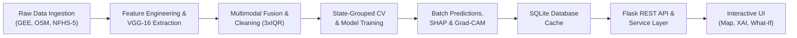

# GeoPoverty AI

An explainable, multimodal Geospatial Artificial Intelligence (GeoAI) platform for **area-level** socioeconomic deprivation estimation using satellite remote sensing, nocturnal radiance, accessibility networks, and machine learning.

[](https://www.python.org/)
[](https://flask.palletsprojects.com/)
[](LICENSE)
[](tests/test_pipeline.py)
[](explainability/)

---

> **Scope & Ethical Statement:**  
> This system estimates socioeconomic deprivation at the aggregate geographic administrative level (**districts**), learned against survey-based ground truth (e.g., NFHS-5 / Census). It does **not** identify, track, or profile individual persons or households. Satellite observations and geospatial metrics are treated as **statistical correlates** of area deprivation—not direct causal explanations or absolute measurements. This is an academic research and decision-support prototype, not validated for operational welfare-targeting decisions.

---

## Table of Contents

1. [Project Overview](#project-overview)
2. [Core Functionalities & Features](#core-functionalities--features)
3. [System Architecture](#system-architecture)
4. [Data Ingestion & Feature Engineering](#data-ingestion--feature-engineering)
5. [Machine Learning & Spatial Cross-Validation](#machine-learning--spatial-cross-validation)
6. [Explainable AI (XAI) Framework](#explainable-ai-xai-framework)
7. [Frontend Web Dashboard](#frontend-web-dashboard)
8. [Complete REST API Reference](#complete-rest-api-reference)
9. [Database Schema & Architecture](#database-schema--architecture)
10. [Quick Start & Setup Guide](#quick-start--setup-guide)
    - [Option A: Instant Demo Mode (Zero External Accounts)](#option-a-instant-demo-mode-zero-external-accounts)
    - [Option B: Real-World Data Pipeline (All-India NFHS-5 + GEE)](#option-b-real-world-data-pipeline-all-india-nfhs-5--gee)
11. [Testing & Quality Assurance](#testing--quality-assurance)
12. [Project Directory Layout](#project-directory-layout)
13. [Ethical Boundary & Scientific Disclaimers](#ethical-boundary--scientific-disclaimers)

---

## Project Overview

Socioeconomic census and demographic surveys in developing nations are resource-intensive, often conducted only once every 5 to 10 years. Consequently, policy planning and regional resource allocation often rely on outdated indicators. 

**GeoPoverty AI** bridges this temporal and spatial gap by combining multi-source Earth Observation (EO) satellite telemetry, open infrastructure data, and survey ground truth into an automated, explainable predictive pipeline:

- **Multimodal Data Fusion**: Combines high-resolution optical imagery (Sentinel-2), nocturnal luminosity (VIIRS), settlement density (GHSL), and road/amenity accessibility (OpenStreetMap) with survey-based targets (NFHS-5).
- **Deep Representation Learning**: Employs a pre-trained VGG-16 convolutional neural network as a frozen feature extractor to extract 512-dimensional visual representations from satellite patches.
- **Geography-Aware Validation**: Implements state-level grouped cross-validation (`GroupKFold`) to eliminate spatial autocorrelation leakage.
- **Dual-Tier Explainable AI**: Combines game-theoretic SHAP attributions for tabular features with Grad-CAM heatmaps for satellite visual patterns.
- **Decision Support Tools**: Includes an interactive Leaflet choropleth map, live "What-If" policy sensitivity simulation, DBSCAN hotspot clustering, statistical district matchmaker, and automated PDF dossier generation.

---

## Core Functionalities & Features

### 1. Geospatial & Satellite Feature Extraction
- **Multispectral Vegetation (NDVI)**: Cloud-masked Sentinel-2 surface reflectance composite (10m resolution) using Scene Classification Layer (SCL) to compute district-wide Normalized Difference Vegetation Index ($NDVI = \frac{NIR - Red}{NIR + Red}$).
- **Nighttime Luminosity (VIIRS DNB)**: Monthly average nocturnal radiance composite ($nW \cdot cm^{-2} \cdot sr^{-1}$) serving as a proxy for electrification, economic output, and commercial activity.
- **Human Settlement & Built-Up Surface (GHSL)**: High-resolution built-up surface percentage and population density grids.
- **Infrastructure Accessibility (OSMnx)**: Road network density ($km/km^2$), distance to nearest healthcare center ($km$), and distance to nearest primary/secondary school ($km$).
- **Deep Visual Texture (VGG-16)**: Frozen pre-trained convolutional backbone producing 512-dimensional bottleneck embeddings representing terrain, housing density, and landscape structure.

### 2. Robust Multimodal Feature Fusion (`preprocessing/feature_fusion.py`)
- Standardized entity matching across geographic identifiers.
- State-grouped median imputation for handling missing observations without target leakage.
- Relaxed $3.0 \times \text{IQR}$ outlier filtering designed to preserve genuine geographic extremes (such as isolated mountainous districts or dense urban cores).

### 3. Spatial Cross-Validation & Modeling (`training/`)
- **Spatial Leakage Defense (`geo_validation.py`)**: Standard random train/test splits suffer from spatial autocorrelation where adjacent districts share socioeconomic and climatic conditions. GeoPoverty AI partitions validation sets across **entire administrative states** (`GroupKFold`).
- **Multiple Regressors (`train_models.py`)**:
  - Baseline: Ordinary Least Squares (OLS) Linear Regression.
  - Ensemble: Random Forest Regressor (`n_estimators=100-300`, `max_depth=5-15`).
  - Gradient Boosting: XGBoost Regressor tuned via `RandomizedSearchCV`.
- **Empirical Tertile Discretization**: Deprivation scores ($[0.0, 1.0]$) are categorized into `Low`, `Medium`, and `High` using empirical tertile thresholds derived strictly from training folds.

### 4. Dual-Tier Explainable AI (XAI) (`explainability/`)
- **Local & Global SHAP (`shap_explain.py`)**: Additive decomposition of predictions:
  $$\hat{y}_i = \phi_0 + \sum_{j=1}^{M} \phi_{ij}$$
  Quantifies exactly which features push a district's score upward (increasing deprivation) or downward (decreasing deprivation).
- **Computer Vision Grad-CAM (`gradcam.py`)**: Computes gradient activations at VGG-16 `block5_conv3` feature maps, generating spatial heatmaps that highlight visual infrastructure and land cover driving the model's visual perception.

### 5. AI District Matchmaker (`/matchmaker`)
- Calculates Z-score standardized Euclidean distances across all AI features to identify the **top 5 most statistically similar districts** across the country.
- Enables policymakers to identify "twin" districts that share structural, environmental, and infrastructure profiles for peer policy benchmarking.

### 6. Interactive "What-If" Policy Simulator (`/whatif`)
- Allows planners to simulate infrastructure interventions (e.g., expanding road connectivity, increasing electrification, or constructing local health clinics).
- Evaluates modified feature vectors in real time, projecting changes in the continuous deprivation score and categorical classification alongside confidence notes.

### 7. Spatial Hotspot & Regional Cluster Detection (`/hotspots`)
- Employs **DBSCAN** (Density-Based Spatial Clustering of Applications with Noise) using the Haversine metric on geographic coordinates.
- Isolates contiguous clusters of high-deprivation districts to highlight priority intervention zones rather than isolated anomalies.

### 8. Multi-District Comparative Analysis (`/compare`)
- Select and evaluate between 2 and 5 districts simultaneously.
- Renders side-by-side radar charts and feature comparison tables comparing road density, healthcare access, nighttime radiance, and visual indicators.

### 9. Automated Executive PDF & Web Reporting (`/report/<id>`)
- Built-in report previewer with responsive layouts.
- Dynamic **ReportLab PDF Engine** producing publication-grade policy briefs with district scorecards, satellite imagery, Grad-CAM attention maps, and SHAP attribution charts.

### 10. Enterprise Authentication, RBAC & Audit Logging (`backend/api/auth.py`, `admin.py`)
- Role-Based Access Control supporting 3 tiers:
  - `PUBLIC`: Explore maps, search districts, run live predictions, and evaluate scenarios.
  - `RESEARCHER`: Access in-depth diagnostic data and export full PDF dossiers.
  - `ADMIN`: Manage user roles, monitor database health, and inspect audit logs.
- Werkzeug password hashing, session management, and chronological audit trail logging.

### 11. Data Quality & Ingest Monitoring (`/data-quality`)
- Live dashboard displaying database record counts, missing value rates across remote sensing bands, and feature distribution health.

---

## System Architecture

```
+-------------------------------------------------------------------------------+
|                       TIER 6: CLIENT PRESENTATION LAYER                       |
|   Leaflet.js Map | Chart.js XAI | District Drilldown | Scenario Simulator     |
+---------------------------------------▲---------------------------------------+
                                        │ HTTP / JSON / GeoJSON / PNG
+---------------------------------------▼---------------------------------------+
|                       TIER 5: APPLICATION & BACKEND API                       |
|   Flask 3.0.3 Web App | REST Endpoints (/api/*) | Session RBAC | PDF Engine   |
+---------------------------------------▲---------------------------------------+
                                        │ SQL Queries & Service Invocations
+---------------------------------------▼---------------------------------------+
|                    TIER 4: EXPLAINABLE AI & ANALYTICS ENGINE                  |
|   SHAP (TreeExplainer) | Grad-CAM Visual Heatmaps | DBSCAN Hotspot Clustering |
+---------------------------------------▲---------------------------------------+
                                        │ Predictions & Latent Embeddings
+---------------------------------------▼---------------------------------------+
|                   TIER 3: PREDICTIVE MODELING & INFERENCE                     |
|   XGBoost Regressor | Random Forest | State-Grouped CV (No Spatial Leakage)   |
+---------------------------------------▲---------------------------------------+
                                        │ Fused Tabular Feature Vector
+---------------------------------------▼---------------------------------------+
|                  TIER 2: DEEP VISION & MULTIMODAL FEATURE FUSION               |
|   Frozen VGG-16 Backbone (512-d) | 3xIQR Outlier Filter | Median Imputation   |
+---------------------------------------▲---------------------------------------+
                                        │ Raw Geometries, Rasters, Survey Stats
+---------------------------------------▼---------------------------------------+
|                     TIER 1: MULTI-SOURCE INGESTION & DATA                     |
|   Sentinel-2 MSI | VIIRS Nightlights | GHSL Built-Up | OSMnx | Census / NFHS  |
+-------------------------------------------------------------------------------+
```

### End-to-End Pipeline Workflow



---

## Data Ingestion & Feature Engineering

| Feature Category | Source Layer / Sensor | Spatial Resolution | Extracted Variables | Description |
|---|---|---|---|---|
| **Vegetation / Agriculture** | Sentinel-2 MSI (S2_SR) | 10 meters | `ndvi_mean` | Cloud-masked optical surface reflectance; vegetation vitality index |
| **Electrification / Nightlights** | VIIRS Day/Night Band | ~500 meters | `nightlight_mean` | Nocturnal anthropogenic radiance ($nW \cdot cm^{-2} \cdot sr^{-1}$) |
| **Human Settlement** | GHSL Built-Up Grid | 100 meters | `builtup_pct` | Percentage of land covered by permanent structures |
| **Population Density** | GHSL Population Grid | 100 meters | `population_density` | Estimated population per square kilometer |
| **Transportation Network** | OpenStreetMap (OSMnx) | Vector Road Graph | `road_density_km_per_sqkm` | Total drivable road length per district area ($km/km^2$) |
| **Education Accessibility** | OpenStreetMap (OSMnx) | Point of Interest (POI) | `school_distance_km` | Euclidean / network distance to nearest school ($km$) |
| **Healthcare Accessibility** | OpenStreetMap (OSMnx) | Point of Interest (POI) | `hospital_distance_km` | Distance to nearest hospital / primary health clinic ($km$) |
| **Visual Texture & Structure** | Sentinel-2 RGB Patches | $224 \times 224$ pixels | `vgg_feat_1` to `vgg_feat_512` | 512-d bottleneck embeddings from frozen pre-trained VGG-16 |
| **Ground Truth Deprivation** | NFHS-5 District Factsheets | District Administrative Level | `deprivation_score` | Normalized composite deprivation score ($[0.0, 1.0]$) |

---

## Machine Learning & Spatial Cross-Validation

### The Spatial Autocorrelation Challenge
In spatial statistics (Tobler's First Law of Geography), adjacent locations are more similar than distant locations. A naive random $k$-fold cross-validation results in data leakage because training and validation sets share nearby geographic districts.

**GeoPoverty AI's Solution**:
- **State-Disjoint Cross-Validation (`GroupKFold`)**: Holds out entire administrative states during each fold.
- Models are evaluated strictly on their ability to generalize to unseen geographic regions with different topography, governance, and demographics.

### Evaluated Model Architectures

1. **Ordinary Least Squares (OLS) Linear Regression**: Linear baseline with standard feature scaling.
2. **Random Forest Regressor**: Non-linear ensemble model with bagging.
3. **XGBoost Regressor**: Gradient-boosted decision trees optimized via `RandomizedSearchCV`.

### Evaluation Metrics
- **Mean Absolute Error (MAE)**: Average absolute divergence between predicted and actual deprivation score.
- **Root Mean Squared Error (RMSE)**: Penalizes larger prediction errors.
- **Coefficient of Determination ($R^2$)**: Proportion of variance explained across spatially held-out states.

---

## Explainable AI (XAI) Framework

### 1. Tabular Attributions: Game-Theoretic SHAP
- Uses `shap.TreeExplainer` on the best tree model to compute exact Shapley values.
- Decomposes every prediction into a **base value** (nationwide average expected score) plus positive and negative feature contributions.
- Positive SHAP value $\rightarrow$ feature pushes deprivation **higher**.
- Negative SHAP value $\rightarrow$ feature pulls deprivation **lower** (protective factor).

### 2. Deep Vision: Grad-CAM Overlays
- Computes the gradient of the mean feature activations with respect to the final convolutional block (`block5_conv3`).
- Generates a heat activation map indicating which pixel clusters in the satellite patch contributed most to the extracted visual representation.
- Overlays the colormap directly onto the natural-color Sentinel-2 patch for intuitive visual interpretation.

---

## Frontend Web Dashboard

| Page Route | View Name | Description | Key Features |
|---|---|---|---|
| `/` | Home / Overview | National executive summary | Top vulnerable districts, high-level metrics, quick links |
| `/map` | Spatial Choropleth Map | Leaflet.js interactive map | GeoJSON district polygons, color ramp by category, layer toggle |
| `/district/<id>` | District Deep-Dive | Comprehensive district dossier | Scorecards, satellite patch, Grad-CAM overlay, SHAP chart |
| `/prediction` | Live AI Predictor | Real-time prediction sandbox | Preset profiles, custom slider inputs, live SHAP attribution |
| `/whatif` | Policy Simulator | What-If policy sensitivity tool | Adjust road/nightlight/health inputs, calculate predicted shifts |
| `/matchmaker` | AI District Matchmaker | Multi-dimensional district search | Statistical twin discovery using Z-score normalized distances |
| `/hotspots` | Spatial Hotspots | DBSCAN cluster visualization | Identifies regional high-deprivation corridors |
| `/compare` | District Comparison | Multi-district evaluation | Compare 2-5 districts side-by-side with radar charts and tables |
| `/report/<id>` | District Report Preview | In-browser dossier preview | Publication-ready view with direct PDF export trigger |
| `/performance` | Model Performance | ML validation metrics | $R^2$, MAE, RMSE charts across all evaluated models |
| `/data-quality` | Data Quality Monitor | Dataset ingest & coverage health | Tracks missing values, null rates, and distribution histograms |
| `/admin` | Admin Portal | System management & audit | User role elevation, system metrics, audit log records |
| `/login` & `/register` | Authentication | Secure user access | Werkzeug password hashing, session authentication |

---

## Complete REST API Reference

All API routes are served under the `/api` prefix.

### Public Endpoints

| Method | Endpoint | Description | Query / Body Params | Response Structure |
|---|---|---|---|---|
| `GET` | `/api/areas` | List of all monitored districts | None | `[{"area_id": 1, "area_name": "...", "state_name": "...", "centroid_lat": ..., "centroid_lon": ...}]` |
| `GET` | `/api/predict/<area_id>` | Predicted score, category, and metadata | None | `{"area_id": 1, "predicted_score": 0.32, "predicted_category": "Low", "model_name": "...", "satellite_available": true}` |
| `GET` | `/api/map` | Full GeoJSON FeatureCollection with predictions | None | `[{"area_id": 1, "area_name": "...", "predicted_score": ..., "boundary_geojson": "..."}]` |
| `GET` | `/api/explain/<area_id>` | SHAP breakdown and Grad-CAM availability | None | `{"area_id": 1, "shap_explanation": {...}, "gradcam_available": true, "gradcam_url": "..."}` |
| `GET` | `/api/satellite-image/<area_id>` | Serves raw RGB satellite patch image | None | Binary image (`image/png`) |
| `GET` | `/api/gradcam/<area_id>` | Serves precomputed Grad-CAM overlay PNG | None | Binary image (`image/png`) |
| `GET` | `/api/model-performance` | Evaluation metrics across models | None | `[{"model_name": "XGBoost", "mae": 0.091, "rmse": 0.111, "r2": ...}]` |
| `GET` | `/api/area-features/<area_id>` | Current feature vector for a district | None | `{"nightlight_mean": 1.25, "ndvi_mean": 0.45, "builtup_pct": 85.2, ...}` |
| `POST` | `/api/scenario` | Run live sensitivity scenario prediction | `{"area_id": 1, "modified_features": {"builtup_pct": 50.0}}` | `{"original_score": 0.42, "scenario_score": 0.38, "difference": -0.04, ...}` |
| `POST` | `/api/predict-live` | Live inference on custom feature inputs | `{"nightlight_mean": 2.5, "builtup_pct": 80, ...}` | `{"predicted_score": ..., "predicted_category": "...", "contributions": [...]}` |
| `GET` | `/api/similar-districts/<area_id>` | Top 5 statistically similar districts | None | `[{"area_id": 12, "area_name": "...", "similarity": 94.2, ...}]` |
| `POST` | `/api/compare` | Multi-district comparison (2-5 districts) | `{"area_ids": [1, 2, 3]}` | `[{"area_id": 1, "predicted_score": ..., "features": {...}}]` |
| `GET` | `/api/hotspots` | DBSCAN spatial cluster regions | None | `[{"cluster_id": 0, "avg_score": 0.72, "center_lat": ..., "districts": [...]}]` |
| `GET` | `/api/data-quality` | Data quality and missingness stats | None | `{"total_districts": 534, "feature_completeness": {...}}` |

### Authentication & User Endpoints

| Method | Endpoint | Description | Access Tier | Body / Payload |
|---|---|---|---|---|
| `POST` | `/api/auth/register` | Register new user account | Public | `{"name": "...", "email": "...", "password": "..."}` |
| `POST` | `/api/auth/login` | Log in and set session cookie | Public | `{"email": "...", "password": "..."}` |
| `POST` | `/api/auth/logout` | Terminate session | Authenticated | None |
| `GET` | `/api/auth/profile` | Retrieve active user session profile | Authenticated | None |

### Reports & Admin Endpoints

| Method | Endpoint | Description | Access Tier |
|---|---|---|---|
| `GET` | `/api/reports/district/<area_id>` | Download structured PDF dossier | `RESEARCHER`, `ADMIN` |
| `GET` | `/api/reports/district-data/<area_id>` | JSON payload for in-browser report preview | `RESEARCHER`, `ADMIN` |
| `GET` | `/api/admin/dashboard-stats` | System counts, active users, and dataset totals | `ADMIN` |
| `GET` | `/api/admin/users` | List registered users and roles | `ADMIN` |
| `PUT` | `/api/admin/users/<user_id>/role` | Update user authorization role (`PUBLIC`, `RESEARCHER`, `ADMIN`) | `ADMIN` |
| `GET` | `/api/admin/audit-logs` | Retrieve chronological security audit trail | `ADMIN` |

---

## Database Schema & Architecture

The database is built on SQLite (located at `database/geopoverty.db`) and structured around 9 relational tables:

```
+-----------------------------------------------------------------------------------+
|                                 DATABASE SCHEMA                                   |
+-----------------------------------------------------------------------------------+

   [users]
   ├── user_id (PK, Integer)
   ├── name (Text)
   ├── email (Text, Unique)
   ├── password_hash (Text)
   ├── role (Text: 'PUBLIC', 'RESEARCHER', 'ADMIN')
   ├── status (Text: 'active', 'inactive')
   └── created_at (Timestamp)

   [audit_logs]
   ├── id (PK, Integer)
   ├── user_id (FK -> users.user_id)
   ├── action (Text)
   ├── timestamp (Timestamp)
   └── details (Text)

   [areas] ────────────────────────────────────────────────────────┐
   ├── area_id (PK, Integer)                                       │
   ├── area_name (Text)                                            │
   ├── state_name (Text)                                           │
   ├── centroid_lat (Real)                                         │
   ├── centroid_lon (Real)                                         │
   ├── boundary_geojson (Text)                                     │
   └── data_mode (Text: 'demo' or 'real')                          │
                                                                   │
   [ground_truth] ◄────────────────────────────────────────────────┤
   ├── gt_id (PK, Integer)                                         │
   ├── area_id (FK -> areas.area_id)                               │
   ├── deprivation_score (Real: 0.0 - 1.0)                         │
   ├── data_source (Text)                                          │
   └── data_year (Integer)                                         │
                                                                   │
   [satellite_data] ◄──────────────────────────────────────────────┤
   ├── sat_id (PK, Integer)                                        │
   ├── area_id (FK -> areas.area_id)                               │
   ├── image_path (Text)                                           │
   ├── source (Text: 'Sentinel-2')                                 │
   ├── capture_date (Text)                                         │
   └── cloud_pct (Real)                                            │
                                                                   │
   [geospatial_features] ◄─────────────────────────────────────────┤
   ├── feature_id (PK, Integer)                                    │
   ├── area_id (FK -> areas.area_id)                               │
   ├── nightlight_mean, ndvi_mean, builtup_pct, population_density  │
   └── road_distance_km, school_distance_km, hospital_distance_km  │
                                                                   │
   [predictions] ◄─────────────────────────────────────────────────┘
   ├── prediction_id (PK, Integer)
   ├── area_id (FK -> areas.area_id)
   ├── model_name (Text)
   ├── predicted_score (Real)
   ├── predicted_category (Text: 'Low', 'Medium', 'High')
   └── prediction_timestamp (Timestamp)
          │
          ▼
   [explanations]
   ├── explain_id (PK, Integer)
   ├── prediction_id (FK -> predictions.prediction_id)
   ├── shap_json (Text / JSON)
   └── gradcam_image_path (Text)

   [model_results]
   ├── result_id (PK, Integer)
   ├── model_name (Text)
   ├── mae, rmse, r2 (Real)
   ├── trained_on ('demo' or 'real')
   └── eval_timestamp (Timestamp)
```

---

## Quick Start & Setup Guide

### Prerequisites
- Python 3.10 or 3.11 installed.
- Git installed.
- Standard CPU (no dedicated GPU required; VGG-16 feature extraction runs in CPU mode).

### Installation

```bash
# 1. Clone repository
git clone https://github.com/your-username/GeoPovertyAI.git
cd GeoPovertyAI

# 2. Create virtual environment
python -m venv venv

# Activate virtual environment:
# Windows (PowerShell):
venv\Scripts\Activate.ps1
# Windows (cmd):
venv\Scripts\activate.bat
# Linux/macOS:
source venv/bin/activate

# 3. Install dependencies
pip install -r requirements.txt
```

---

### Option A: Instant Demo Mode (Zero External Accounts)

Demo mode uses a pre-generated synthetic dataset of 60 districts across 6 states with realistic geospatial relationships. This allows the complete system (database, model training, SHAP, Grad-CAM, API, and frontend) to be run immediately without third-party API credentials.

#### One-Command Pipeline Execution:

**On Windows (PowerShell):**
```powershell
.\scripts\run_full_demo_pipeline.ps1
```

**On Linux / macOS:**
```bash
bash scripts/run_full_demo_pipeline.sh
```

#### Step-by-Step Manual Execution (Demo Mode):
```bash
# 1. Initialize SQLite Database
python database/init_db.py

# 2. Generate Synthetic Demo Data & Images
python scripts/generate_demo_data.py
python preprocessing/generate_demo_images.py

# 3. Load Demo Records into Database
python scripts/load_demo_to_db.py

# 4. Train Models with State-Grouped CV
python training/train_models.py --data data/demo/demo_training_data.csv

# 5. Precompute Predictions, SHAP & Grad-CAM
python scripts/precompute_predictions.py --data data/demo/demo_training_data.csv

# 6. Launch Application
python backend/app.py
```
Open **`http://127.0.0.1:5000`** in your browser.

---

### Option B: Real-World Data Pipeline (All-India NFHS-5 + GEE)

To run the pipeline on real nationwide data covering 534+ districts across Indian states:

#### 1. Google Earth Engine Setup
Follow the instructions in [`geospatial/GEE_SETUP.md`](geospatial/GEE_SETUP.md):
```bash
earthengine authenticate
```

#### 2. Extract Boundaries and Satellite Features for All 34 States
```bash
python scripts/extract_all_india_features.py
```
*Outputs: `data/raw/districts_<State>.json` and `data/processed/real_geospatial_features.csv`.*

#### 3. Prepare Survey Ground Truth
The ground-truth NFHS-5 district factsheets are processed via:
```bash
python scripts/prepare_real_ground_truth.py
```
*Outputs: `data/ground_truth/real_ground_truth.csv`.*

#### 4. Fuse Multimodal Data
```bash
python scripts/build_real_training_table.py
```
*Outputs: `data/processed/final_training_table.csv`.*

#### 5. Train Models & Precompute Predictions on Real Data
```bash
# Train models on real fused table
python training/train_models.py --data data/processed/final_training_table.csv

# Precompute batch predictions, SHAP, and Grad-CAM
python scripts/precompute_predictions.py --data data/processed/final_training_table.csv
```

#### 6. Launch Server
```bash
python backend/app.py
```
The application backend automatically detects and prefers `final_training_table.csv` over the demo table.

---

## Testing & Quality Assurance

The test suite contains **23 comprehensive tests** covering data generation, feature fusion edge cases, spatial validation integrity, model column alignment, and Flask REST API endpoints:

```bash
pytest tests/ -v
```

### Test Coverage Highlights:
- `test_demo_dataset_shape_and_no_missing_values`: Ensures complete dataset creation without nulls.
- `test_demo_dataset_reproducible_with_same_seed`: Verifies deterministic data generation.
- `test_remove_duplicates_keeps_first`: Validates deduplication logic.
- `test_impute_missing_fills_with_median`: Confirms missing feature imputation using fold medians.
- `test_clip_outliers_bounds_extreme_values`: Checks $3.0 \times \text{IQR}$ outlier filtering.
- `test_fuse_features_end_to_end`: End-to-end integration test of multimodal fusion.
- `test_grouped_split_has_zero_state_overlap`: Verifies that train and test splits share **zero** states, proving zero spatial data leakage.
- `test_api_areas_returns_list`: Tests `/api/areas` endpoint response schema.
- `test_api_predict_returns_correct_fields`: Tests `/api/predict/<id>` schema.
- `test_api_scenario_valid_request`: Validates "What-If" simulator response and calculations.
- `test_api_scenario_invalid_area_returns_404`: Verifies robust error boundary handling.

---

## Project Directory Layout

```
GeoPovertyAI/
│
├── backend/
│   ├── app.py                      # Flask application factory, routes & entry point
│   ├── api/
│   │   ├── routes.py               # REST API endpoints (/api/*)
│   │   ├── auth.py                 # Authentication & RBAC controllers
│   │   ├── reports.py              # ReportLab automated PDF dossier generation
│   │   └── admin.py                # Admin dashboard stats, role updates & audit logs
│   └── services/
│       ├── db_service.py           # Thread-safe database transactions
│       ├── model_service.py        # Model inference & live what-if simulation
│       └── hotspot_service.py      # DBSCAN geospatial clustering logic
│
├── frontend/
│   ├── templates/                  # 18 Jinja2 HTML templates
│   │   ├── base.html               # Shared layout, navbar, and auth states
│   │   ├── home.html               # Executive overview dashboard
│   │   ├── map.html                # Interactive Leaflet choropleth map
│   │   ├── district.html           # Unified district analysis & XAI drilldown
│   │   ├── prediction.html         # Live prediction sandbox with preset profiles
│   │   ├── whatif.html             # Policy intervention sensitivity simulator
│   │   ├── matchmaker.html         # AI statistical twin district matchmaker
│   │   ├── hotspots.html           # Regional spatial hotspot clusters
│   │   ├── compare.html            # Side-by-side multi-district comparison
│   │   ├── report.html             # In-browser HTML report preview
│   │   ├── performance.html        # Model evaluation metrics & charts
│   │   ├── data_quality.html       # Dataset health & missingness monitor
│   │   ├── admin_dashboard.html    # User management & security audit trail
│   │   ├── login.html & register.html
│   │   └── about.html              # Methodology, data sources & ethics
│   └── static/
│       ├── css/style.css           # Styling system & UI tokens
│       └── js/formatters.js        # Data formatting & utility scripts
│
├── geospatial/
│   ├── GEE_SETUP.md                # Google Earth Engine setup & authentication guide
│   ├── gee_config.py               # GEE asset IDs, bands, and credentials
│   ├── fetch_district_boundaries.py# FAO GAUL boundary polygon acquisition
│   ├── extract_geospatial_features.py # Extraction for Sentinel-2, VIIRS & GHSL
│   ├── download_satellite_patches.py  # District-centered RGB GeoTIFF/PNG downloader
│   └── extract_accessibility_features.py # OSMnx road density & amenity distance extraction
│
├── preprocessing/
│   ├── image_preprocessing.py      # Image resizing (224x224) & normalization
│   ├── vgg16_feature_extractor.py  # Frozen VGG-16 deep feature extractor (512-d)
│   ├── generate_demo_images.py     # Deterministic synthetic satellite patch generator
│   └── feature_fusion.py           # Fusion pipeline with median imputation & 3xIQR clipping
│
├── training/
│   ├── geo_validation.py           # Spatial state-grouped cross-validation (GroupKFold)
│   └── train_models.py             # Linear Regression, Random Forest, XGBoost tuning
│
├── explainability/
│   ├── shap_explain.py             # SHAP local additive contributions & global importance
│   ├── gradcam.py                  # Gradient-weighted Class Activation Mapping for VGG-16
│   └── outputs/                    # Precomputed Grad-CAM PNG heatmaps
│
├── database/
│   ├── schema.sql                  # Relational schema DDL (9 tables)
│   ├── init_db.py                  # Database initialization script
│   └── geopoverty.db               # SQLite database file
│
├── data/
│   ├── raw/                        # District boundary JSONs
│   ├── processed/                  # Geospatial CSVs, accessibility CSVs & final fused table
│   ├── satellite/                  # Downloaded and demo satellite image patches
│   ├── ground_truth/               # NFHS-5 survey ground-truth CSV & documentation
│   └── demo/                       # 60-district synthetic demo dataset
│
├── models/
│   ├── best_model.pkl              # Serialized trained model bundle
│   ├── feature_columns.json        # Ordered list of feature names
│   ├── category_thresholds.json    # Empirical tertile boundaries (Low / Medium / High)
│   └── model_comparison_results.csv# Performance metrics across evaluated models
│
├── scripts/
│   ├── extract_all_india_features.py # Master 34-state GEE extraction script
│   ├── build_real_training_table.py  # Fuses real GEE features with NFHS-5 ground truth
│   ├── generate_demo_data.py         # Synthetic demo dataset generator
│   ├── load_demo_to_db.py            # Loads demo records into SQLite database
│   ├── precompute_predictions.py     # Batch prediction, SHAP, and Grad-CAM precomputer
│   ├── run_full_demo_pipeline.ps1    # One-click Windows PowerShell pipeline runner
│   └── run_full_demo_pipeline.sh     # One-click Bash pipeline runner
│
├── tests/
│   └── test_pipeline.py            # 19 automated PyTest validation tests
│
├── config.py                       # Shared directory paths and global constants
├── requirements.txt                # Pinned Python package dependencies
└── README.md                       # Complete project documentation
```

---

## Ethical Boundary & Scientific Disclaimers

1. **Area-Level Aggregate Only**: This system does not observe, analyze, or predict individual persons or households. The fundamental spatial unit of analysis is the administrative district.
2. **Correlation vs. Causality**: Satellite indicators (such as nocturnal radiance and vegetation indices) and accessibility metrics are statistically associated with socioeconomic conditions; they do not represent causal explanations for poverty.
3. **Simulation Disclaimer**: The "What-If" policy simulator evaluates the statistical sensitivity of the trained machine learning model. It does not replace comprehensive econometrics or randomized control trials (RCTs).
4. **Data Tagging**: All synthetic records are explicitly tagged with `data_mode='demo'` throughout the database and user interface to ensure synthetic data is never confused with empirical ground truth.

---

## License

This project is licensed under the MIT License — see the [LICENSE](LICENSE) file for details.
