# SOFTWARE DESIGN SPECIFICATION (SDS)
## GeoPoverty AI: Multimodal Explainable AI System for Area-Level Socioeconomic Deprivation Estimation

**Document Version:** 1.0.0  
**Project:** GeoPoverty AI  
**Scope:** Machine Learning, Geospatial Remote Sensing, and Decision-Support System  
**Target Unit of Analysis:** Administrative District Level (Aggregated Area Level)  

---

## Table of Contents
1. [System Design](#1-system-design)
   - [1.1 Architectural Design](#11-architectural-design)
     - [1.1.1 System Context Diagram](#111-system-context-diagram)
     - [1.1.2 End-to-End ML Pipeline Diagram](#112-end-to-end-ml-pipeline)
2. [Detailed Design](#2-detailed-design)
   - [2.1 Dataset Design](#21-dataset-design)
     - [2.1.1 Dataset Provenance and Permissions](#211-dataset-provenance-and-permissions)
     - [2.1.2 Dataset Schema and Data Dictionary](#212-dataset-schema-and-data-dictionary)
     - [2.1.3 Target / Label Definition](#213-target--label-definition)
     - [2.1.4 Partitioning and Leakage Prevention](#214-partitioning-and-leakage-prevention)
   - [2.2 Preprocessing and Feature Engineering](#22-preprocessing-and-feature-engineering)
     - [2.2.1 Validation and Cleaning](#221-validation-and-cleaning)
     - [2.2.2 Feature Selection and Extraction](#222-feature-selection-and-extraction)
   - [2.3 Model Design](#23-model-design)
     - [2.3.1 Baseline and Candidate Models](#231-baseline-and-candidate-models)
     - [2.3.2 Model Architecture and Hyperparameters](#232-model-architecture-and-hyperparameters)
   - [2.4 Database Design](#24-database-design)
     - [2.4.1 ER Diagram and Storage Architecture](#241-er-diagram-and-storage-architecture)
     - [2.4.2 Schema Specification](#242-schema-specification)
     - [2.4.3 Database DDL Script](#243-database-ddl-script)
   - [2.5 UML and Behavioral Design](#25-uml-and-behavioral-design)
     - [2.5.1 Use Case Diagram](#251-use-case-diagram)
     - [2.5.2 Class and Component Diagram](#252-class-and-component-diagram)
     - [2.5.3 Sequence Diagram](#253-sequence-diagram)
     - [2.5.4 Activity Diagram](#254-activity-diagram)
   - [2.6 User Interface Design](#26-user-interface-design)
     - [2.6.1 UI Architecture and Layout Strategy](#261-ui-architecture-and-layout-strategy)
     - [2.6.2 Key Interface Views and Visual Walkthrough](#262-key-interface-views-and-visual-walkthrough)
     - [2.6.3 Design Aesthetics, Accessibility, and Responsiveness](#263-design-aesthetics-accessibility-and-responsiveness)
3. [References](#3-references)

---

# 1. System Design

## 1.1 Architectural Design

GeoPoverty AI is designed as a **6-Tier Modular Geospatial AI Platform**. It ingests multi-source satellite telemetry and OpenStreetMap networks, extracts deep visual and environmental features, trains spatial regression models free of spatial autocorrelation leakage, provides dual-tier explainability (SHAP + Grad-CAM), and serves decisions via a responsive Flask web interface.

### 1.1.1 System Context Diagram
The System Context Diagram illustrates how primary external actors interact with the GeoPoverty AI application boundaries and external data providers.

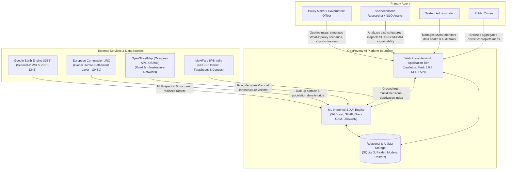

### 1.1.2 End-to-End ML Pipeline
The end-to-end ML lifecycle comprises data ingestion, validation, deep feature extraction, state-grouped partitioning, model training, metric evaluation, precomputed caching, and real-time scenario inference.

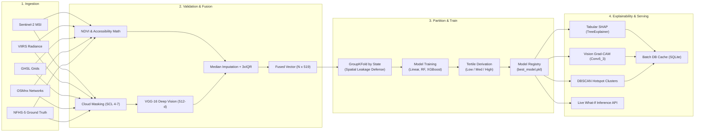

---

# 2. Detailed Design

## 2.1 Dataset Design

### 2.1.1 Dataset Provenance and Permissions
The project strictly respects open data licenses, scientific reproducibility, and ethical safeguards:
- **Sentinel-2 MultiSpectral Instrument (MSI):** European Space Agency (ESA) Copernicus Open Access Policy (Free, full, and open access). 10-meter spatial resolution.
- **VIIRS Day/Night Band (DNB):** NOAA/NASA Earth Observation Group (Public Domain). Monthly average nocturnal radiance composite.
- **Global Human Settlement Layer (GHSL):** European Commission Joint Research Centre (JRC). Open data policy for spatial human presence.
- **OpenStreetMap (OSM):** Open Data Commons Open Database License (ODbL). Extracted via `OSMnx`.
- **National Family Health Survey (NFHS-5, 2019–2021) / Census:** Ministry of Health and Family Welfare (MoHFW), Government of India. Aggregated district factsheets.
- **Ethical Boundary:** Data is strictly processed and reported at the administrative district level. Household or individual-level profiling is prohibited by architectural design.

### 2.1.2 Dataset Schema and Data Dictionary
The unified tabular dataset fuses environmental, infrastructural, and visual representations:

| Field Name | Type | Meaning / Unit | Permissible Range | Missingness Strategy | Sensitivity |
|---|---|---|---|---|---|
| `area_id` | `INTEGER` | Unique district administrative ID | `1` to `750` | None (Primary Key) | Non-sensitive |
| `area_name` | `VARCHAR` | Official district name | String | None | Non-sensitive |
| `state_name` | `VARCHAR` | State or Union Territory | String | None | Non-sensitive |
| `centroid_lat` | `FLOAT` | Centroid latitude | `6.0` to `37.0` | 0% | Non-sensitive |
| `centroid_lon` | `FLOAT` | Centroid longitude | `68.0` to `97.5` | 0% | Non-sensitive |
| `nightlight_mean` | `FLOAT` | VIIRS radiance ($nW \cdot cm^{-2} \cdot sr^{-1}$) | `0.0` to `150.0` | Median within fold | Non-sensitive |
| `ndvi_mean` | `FLOAT` | Vegetation index ($NIR-Red)/(NIR+Red$) | `[-1.0, 1.0]` | Median within fold | Non-sensitive |
| `builtup_pct` | `FLOAT` | Human-modified surface coverage (%) | `[0.0, 100.0]` | Median within fold | Non-sensitive |
| `population_density`| `FLOAT` | Settlement density ($persons / km^2$) | `0.0` to `40000.0` | Median within fold | Non-sensitive |
| `road_distance_km`| `FLOAT` | Mean distance to primary highway (km) | `0.1` to `50.0` | Median within fold | Non-sensitive |
| `school_distance_km`| `FLOAT` | Distance to nearest school (km) | `0.1` to `25.0` | Median within fold | Non-sensitive |
| `hospital_distance_km`| `FLOAT` | Distance to secondary/tertiary hospital (km) | `0.5` to `75.0` | Median within fold | Non-sensitive |
| `vgg16_feat_0`–`511`| `FLOAT` | Dense visual embeddings from VGG-16 | `[-5.0, 5.0]` | 0% (extracted) | Non-sensitive |
| `deprivation_score`| `FLOAT` | Target: Multidimensional deprivation index | `[0.0, 1.0]` | Label column | Public aggregate |

### 2.1.3 Target / Label Definition
- **Continuous Target ($Y$):** `deprivation_score` $\in [0.0, 1.0]$. A value of `0.0` indicates minimal deprivation (high affluence/infrastructure), while `1.0` indicates extreme deprivation.
- **Categorical Presentation Target:** Discretized into three non-overlapping tertiles (`Low`, `Medium`, `High`) derived strictly from empirical training percentiles (33.3% and 66.7%).
- **Annotation Process & Quality:** Derived from standardized government factsheet indicators (drinking water access, sanitation, clean fuel, electrification, female literacy, stunting).

### 2.1.4 Partitioning and Leakage Prevention
- **Spatial Autocorrelation Vulnerability:** In geospatial problems, standard random cross-validation produces severe optimistic bias due to Tobler's First Law of Geography (neighboring districts share unobserved spatial characteristics).
- **Enforced Strategy:** **State-Grouped Partitioning (`GroupKFold`)**. Whole states are held out exclusively in either training or testing folds ($k=5$). Zero geographic overlap exists between training and validation/test folds.
- **Coordinates Exclusion:** `centroid_lat` and `centroid_lon` are strictly excluded from the feature matrix $\mathbf{X}$ to prevent models from memorizing geographical locations.

---

## 2.2 Preprocessing and Feature Engineering

### 2.2.1 Validation and Cleaning
- **Missing Value Handling:** Missing tabular attributes are imputed using the **median of the training partition**; test fold values are never used during imputation parameter calculation.
- **Outlier Treatment:** A relaxed $3.0 \times \text{IQR}$ (Interquartile Range) boundary check is applied to eliminate sensor artifacts while preserving legitimate geographic extremes (e.g., highly dense metropolitan centers or remote Himalayan valleys).
- **Satellite Filtering:** Sentinel-2 optical scenes with $> 10\%$ cloud cover are filtered out. Scene Classification Layer (SCL) masks non-ground pixels.

### 2.2.2 Feature Selection and Extraction
- **Computer Vision Extraction:** Transfer learning using a frozen VGG-16 architecture pretrained on ImageNet. The classification head is removed, and Global Average Pooling is applied to `block5_conv3`, extracting a rich **512-dimensional visual embedding vector**.
- **Multimodal Feature Fusion:**
  $$\mathbf{X}_{\text{fused}} = [\mathbf{x}_{\text{geospatial}} \parallel \mathbf{v}_{\text{vgg16}}] \in \mathbb{R}^{N \times (7 + 512)}$$
  Combining 7 tabular infrastructure/remoteness signals with 512 deep visual latent dimensions.

---

## 2.3 Model Design

### 2.3.1 Baseline and Candidate Models
1. **Baseline Model:** Ordinary Least Squares (Linear Regression) providing an interpretable, parametric reference baseline.
2. **Ensemble Regressor:** Random Forest Regressor (100 estimators, bootstrap sampling) capturing non-linear feature interactions.
3. **Primary Production Regressor:** Tuned XGBoost Regressor (`XGBRegressor`) optimized using `RandomizedSearchCV` under `GroupKFold` spatial splits.

### 2.3.2 Model Architecture and Hyperparameters
- **Objective:** Minimize Root Mean Squared Error ($\mathcal{L}_{\text{RMSE}}$) under regularized gradient boosting:
  $$\mathcal{L} = \sum_{i=1}^n (y_i - \hat{y}_i)^2 + \sum_{k=1}^K \left(\gamma T_k + \frac{1}{2}\lambda \|w_k\|^2\right)$$
- **Primary Hyperparameters:**
  - `n_estimators`: 200
  - `max_depth`: 5
  - `learning_rate`: 0.05
  - `subsample`: 0.8
  - `colsample_bytree`: 0.8
  - `reg_alpha` ($L_1$): 0.1
  - `reg_lambda` ($L_2$): 1.0

---

## 2.4 Database Design

### 2.4.1 ER Diagram and Storage Architecture

GeoPoverty AI implements a **hybrid database architecture**:
- **Structured Relational Storage (SQLite 3):** Houses district geometries, user credentials, tabular features, model registry metrics, batch inferences, and local SHAP feature importances.
- **File & Artifact Repository:** Stores high-dimensional binaries including Sentinel-2 RGB rasters, Grad-CAM attention heatmap PNGs, and serialized model files (`.pkl`, `.json`).

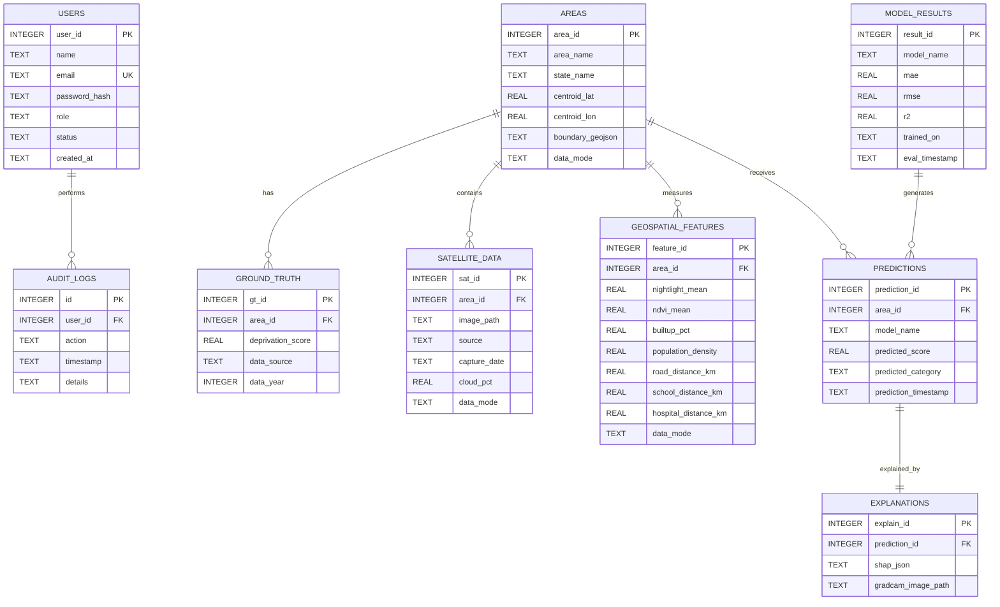

---

### 2.4.2 Schema Specification

The schema is divided into the five standard domains required for ML production systems: **Users**, **Datasets**, **Experiments**, **Model Versions**, and **Predictions**.

#### A. Users and Access Control Schema
Maintains authentication profiles, salted password hashes, and authorization tiers (`PUBLIC`, `RESEARCHER`, `ADMIN`).

**1. Table: `users`**
| Column Name | Type | Constraints | Description | Permissible Range / Example |
|---|---|---|---|---|
| `user_id` | `INTEGER` | `PRIMARY KEY AUTOINCREMENT` | Unique identifier for account | `1`, `2`, `3` |
| `name` | `TEXT` | `NOT NULL` | Full display name of user | `"Prof. Rajiv Sharma"` |
| `email` | `TEXT` | `NOT NULL, UNIQUE` | Registered email address | `"rajiv.sharma@domain.org"` |
| `password_hash` | `TEXT` | `NOT NULL` | Cryptographic hash of password | `scrypt:32768:8:1$...` |
| `role` | `TEXT` | `NOT NULL DEFAULT 'PUBLIC'` | Role-based permission tier | `'PUBLIC'`, `'RESEARCHER'`, `'ADMIN'` |
| `status` | `TEXT` | `NOT NULL DEFAULT 'active'` | Account operational state | `'active'`, `'inactive'` |
| `created_at` | `TEXT` | `DEFAULT CURRENT_TIMESTAMP` | Account registration timestamp | `'2026-02-10 09:15:00'` |

**2. Table: `audit_logs`**
| Column Name | Type | Constraints | Description | Permissible Range / Example |
|---|---|---|---|---|
| `id` | `INTEGER` | `PRIMARY KEY AUTOINCREMENT` | Unique audit event sequence number | `1`, `42` |
| `user_id` | `INTEGER` | `FOREIGN KEY (users.user_id)` | Identity of actor executing action | `1` |
| `action` | `TEXT` | `NOT NULL` | Action code or endpoint invoked | `'USER_LOGIN'`, `'SIMULATE_SCENARIO'`, `'EXPORT_DOSSIER'` |
| `timestamp` | `TEXT` | `DEFAULT CURRENT_TIMESTAMP` | Event timestamp in UTC | `'2026-02-10 09:17:22'` |
| `details` | `TEXT` | `NULLABLE` | JSON or text parameter payload | `{"district_id": 14, "delta_hospital": -5.0}` |

---

#### B. Datasets Schema
Stores administrative units, raw satellite metadata, ground truth survey targets, and computed geospatial signals.

**3. Table: `areas`**
| Column Name | Type | Constraints | Description | Permissible Range / Example |
|---|---|---|---|---|
| `area_id` | `INTEGER` | `PRIMARY KEY AUTOINCREMENT` | Unique district administrative ID | `1` to `534` |
| `area_name` | `TEXT` | `NOT NULL` | District administrative name | `"Nuh"`, `"Sitamarhi"`, `"Dungarpur"` |
| `state_name` | `TEXT` | `NOT NULL` | State or territory jurisdiction | `"Haryana"`, `"Bihar"`, `"Rajasthan"` |
| `centroid_lat` | `REAL` | `NOT NULL` | Geometric latitude centroid | `6.0` to `37.0` (e.g., `28.1130`) |
| `centroid_lon` | `REAL` | `NOT NULL` | Geometric longitude centroid | `68.0` to `97.5` (e.g., `77.0145`) |
| `boundary_geojson`| `TEXT` | `NULLABLE` | GeoJSON polygon coordinates | `{"type":"Polygon","coordinates":[[...]]}` |
| `data_mode` | `TEXT` | `NOT NULL DEFAULT 'demo'` | Environment flag | `'demo'`, `'real'` |

**4. Table: `ground_truth`**
| Column Name | Type | Constraints | Description | Permissible Range / Example |
|---|---|---|---|---|
| `gt_id` | `INTEGER` | `PRIMARY KEY AUTOINCREMENT` | Unique ground truth record | `1`, `2` |
| `area_id` | `INTEGER` | `NOT NULL, FK (areas.area_id)`| Monitored district | References `areas.area_id` |
| `deprivation_score`| `REAL` | `NOT NULL` | Continuous multidimensional target | `[0.0, 1.0]` (0: affluent, 1: severely deprived) |
| `data_source` | `TEXT` | `NOT NULL` | Origin survey instrument | `'NFHS-5'`, `'Census2011'`, `'Census2011_demo'` |
| `data_year` | `INTEGER` | `NULLABLE` | Survey compilation year | `2011`, `2021` |

**5. Table: `satellite_data`**
| Column Name | Type | Constraints | Description | Permissible Range / Example |
|---|---|---|---|---|
| `sat_id` | `INTEGER` | `PRIMARY KEY AUTOINCREMENT` | Unique satellite record | `1`, `2` |
| `area_id` | `INTEGER` | `NOT NULL, FK (areas.area_id)`| Monitored district | References `areas.area_id` |
| `image_path` | `TEXT` | `NULLABLE` | Relative path to 224x224 patch | `'data/satellite/district_14.png'` |
| `source` | `TEXT` | `NOT NULL DEFAULT 'Sentinel-2'`| Remote sensing sensor | `'Sentinel-2 MSI'`, `'Landsat-8'` |
| `capture_date` | `TEXT` | `NULLABLE` | Date of acquisition | `'2023-11-20'` |
| `cloud_pct` | `REAL` | `NULLABLE` | Cloud cover percentage | `0.0` to `100.0` (Target: `< 10%`) |
| `data_mode` | `TEXT` | `NOT NULL DEFAULT 'demo'` | Environment flag | `'demo'`, `'real'` |

**6. Table: `geospatial_features`**
| Column Name | Type | Constraints | Description | Permissible Range / Example |
|---|---|---|---|---|
| `feature_id` | `INTEGER` | `PRIMARY KEY AUTOINCREMENT` | Unique feature row | `1`, `2` |
| `area_id` | `INTEGER` | `NOT NULL, FK (areas.area_id)`| Monitored district | References `areas.area_id` |
| `nightlight_mean` | `REAL` | `NULLABLE` | Mean nocturnal radiance ($nW/cm^2/sr$) | `0.0` to `150.0` (e.g., `9.12`) |
| `ndvi_mean` | `REAL` | `NULLABLE` | Mean vegetation index | `[-1.0, 1.0]` (e.g., `0.341`) |
| `builtup_pct` | `REAL` | `NULLABLE` | Built-up settlement coverage (%) | `[0.0, 100.0]` (e.g., `12.5%`) |
| `population_density`| `REAL` | `NULLABLE` | Settlement density ($persons / km^2$) | `0.0` to `35000.0` |
| `road_distance_km`| `REAL` | `NULLABLE` | Mean distance to primary highway (km) | `0.1` to `50.0` km |
| `school_distance_km`| `REAL` | `NULLABLE` | Distance to nearest educational facility | `0.1` to `25.0` km |
| `hospital_distance_km`| `REAL` | `NULLABLE` | Distance to secondary/tertiary hospital | `0.5` to `70.0` km |
| `data_mode` | `TEXT` | `NOT NULL DEFAULT 'demo'` | Environment flag | `'demo'`, `'real'` |

---

#### C. Experiments Schema
Maintains benchmark results across candidate ML algorithms under spatial cross-validation.

**7. Table: `model_results`**
| Column Name | Type | Constraints | Description | Permissible Range / Example |
|---|---|---|---|---|
| `result_id` | `INTEGER` | `PRIMARY KEY AUTOINCREMENT` | Unique experiment run ID | `1`, `2`, `3` |
| `model_name` | `TEXT` | `NOT NULL` | Architecture evaluated | `'LinearRegression'`, `'RandomForest'`, `'XGBoost'` |
| `mae` | `REAL` | `NOT NULL` | Mean Absolute Error on unseen states | `0.0` to `1.0` (e.g., `0.0682`) |
| `rmse` | `REAL` | `NOT NULL` | Root Mean Squared Error on unseen states | `0.0` to `1.0` (e.g., `0.0891`) |
| `r2` | `REAL` | `NOT NULL` | Coefficient of Determination ($R^2$) | `[-1.0, 1.0]` (e.g., `0.7410`) |
| `trained_on` | `TEXT` | `NOT NULL DEFAULT 'demo'` | Training partition mode | `'demo'`, `'real'` |
| `eval_timestamp` | `TEXT` | `DEFAULT CURRENT_TIMESTAMP` | Evaluation execution time | `'2026-03-01 12:00:00'` |

---

#### D. Model Versions & Artifact Registry Schema
Tracks the physical model binaries and configuration artifacts generated by the ML pipeline:

1. **`models/best_model.pkl`**: Serialized `joblib` dictionary bundle containing:
   - `model`: Trained scikit-learn / XGBoost pipeline object.
   - `model_name`: String identifier of best-performing model.
   - `hyperparameters`: Optimized hyperparameter map.
2. **`models/feature_columns.json`**: An ordered array of 519 feature column names enforcing deterministic column alignments during live inference:
   ```json
   ["nightlight_mean", "ndvi_mean", "builtup_pct", "population_density", "road_distance_km", "school_distance_km", "hospital_distance_km", "vgg16_feat_0", "...", "vgg16_feat_511"]
   ```
3. **`models/category_thresholds.json`**: Data-driven tertile boundaries derived strictly from training data:
   ```json
   {
     "low_medium_boundary": 0.3341,
     "medium_high_boundary": 0.6128,
     "derived_from": "training set deprivation_score tertiles"
   }
   ```

---

#### E. Predictions & Explainability Schema
Stores inferred deprivation indices, categorical classifications, and cached explainability artifacts.

**8. Table: `predictions`**
| Column Name | Type | Constraints | Description | Permissible Range / Example |
|---|---|---|---|---|
| `prediction_id` | `INTEGER` | `PRIMARY KEY AUTOINCREMENT` | Unique prediction record | `1`, `2` |
| `area_id` | `INTEGER` | `NOT NULL, FK (areas.area_id)`| Monitored district | References `areas.area_id` |
| `model_name` | `TEXT` | `NOT NULL` | Model generating prediction | `'XGBoost_v1'` |
| `predicted_score`| `REAL` | `NOT NULL` | Continuous estimated deprivation | `[0.0, 1.0]` (e.g., `0.6841`) |
| `predicted_category`| `TEXT` | `NULLABLE` | Policy classification category | `'Low'`, `'Medium'`, `'High'` |
| `prediction_timestamp`| `TEXT`| `DEFAULT CURRENT_TIMESTAMP` | Prediction time | `'2026-03-01 12:05:00'` |

**9. Table: `explanations`**
| Column Name | Type | Constraints | Description | Permissible Range / Example |
|---|---|---|---|---|
| `explain_id` | `INTEGER` | `PRIMARY KEY AUTOINCREMENT` | Unique explanation record | `1`, `2` |
| `prediction_id` | `INTEGER` | `NOT NULL, UNIQUE, FK (predictions.prediction_id)`| Linked prediction (1:1) | References `predictions.prediction_id` |
| `shap_json` | `TEXT` | `NULLABLE` | Serialized JSON map of SHAP feature values ($\phi_i$) | `{"nightlight_mean": -0.14, "road_dist": 0.08}` |
| `gradcam_image_path`| `TEXT` | `NULLABLE` | Relative path to visual Grad-CAM heatmap | `'explainability/outputs/gradcam_14.png'` |

---

### 2.4.3 Database DDL Script
Executable DDL matching [`database/schema.sql`](file:///d:/geo%20poverty%20project/v2+/GeoPovertyAI_Complete/GeoPovertyAI/database/schema.sql):

```sql
PRAGMA foreign_keys = ON;

CREATE TABLE IF NOT EXISTS users (
    user_id       INTEGER PRIMARY KEY AUTOINCREMENT,
    name          TEXT NOT NULL,
    email         TEXT UNIQUE NOT NULL,
    password_hash TEXT NOT NULL,
    role          TEXT NOT NULL DEFAULT 'PUBLIC',
    status        TEXT NOT NULL DEFAULT 'active',
    created_at    TEXT DEFAULT CURRENT_TIMESTAMP
);

CREATE TABLE IF NOT EXISTS audit_logs (
    id          INTEGER PRIMARY KEY AUTOINCREMENT,
    user_id     INTEGER,
    action      TEXT NOT NULL,
    timestamp   TEXT DEFAULT CURRENT_TIMESTAMP,
    details     TEXT,
    FOREIGN KEY (user_id) REFERENCES users(user_id) ON DELETE SET NULL
);

CREATE TABLE IF NOT EXISTS areas (
    area_id          INTEGER PRIMARY KEY AUTOINCREMENT,
    area_name        TEXT NOT NULL,
    state_name       TEXT NOT NULL,
    centroid_lat     REAL NOT NULL,
    centroid_lon     REAL NOT NULL,
    boundary_geojson TEXT,
    data_mode        TEXT NOT NULL DEFAULT 'demo'
);

CREATE TABLE IF NOT EXISTS ground_truth (
    gt_id               INTEGER PRIMARY KEY AUTOINCREMENT,
    area_id             INTEGER NOT NULL,
    deprivation_score   REAL NOT NULL,
    data_source         TEXT NOT NULL,
    data_year           INTEGER,
    FOREIGN KEY (area_id) REFERENCES areas(area_id) ON DELETE CASCADE
);

CREATE TABLE IF NOT EXISTS satellite_data (
    sat_id          INTEGER PRIMARY KEY AUTOINCREMENT,
    area_id         INTEGER NOT NULL,
    image_path      TEXT,
    source          TEXT NOT NULL DEFAULT 'Sentinel-2',
    capture_date    TEXT,
    cloud_pct       REAL,
    data_mode       TEXT NOT NULL DEFAULT 'demo',
    FOREIGN KEY (area_id) REFERENCES areas(area_id) ON DELETE CASCADE
);

CREATE TABLE IF NOT EXISTS geospatial_features (
    feature_id           INTEGER PRIMARY KEY AUTOINCREMENT,
    area_id              INTEGER NOT NULL,
    nightlight_mean      REAL,
    ndvi_mean            REAL,
    builtup_pct          REAL,
    population_density   REAL,
    road_distance_km     REAL,
    school_distance_km   REAL,
    hospital_distance_km REAL,
    data_mode            TEXT NOT NULL DEFAULT 'demo',
    FOREIGN KEY (area_id) REFERENCES areas(area_id) ON DELETE CASCADE
);

CREATE TABLE IF NOT EXISTS predictions (
    prediction_id        INTEGER PRIMARY KEY AUTOINCREMENT,
    area_id              INTEGER NOT NULL,
    model_name           TEXT NOT NULL,
    predicted_score      REAL NOT NULL,
    predicted_category   TEXT,
    prediction_timestamp TEXT DEFAULT CURRENT_TIMESTAMP,
    FOREIGN KEY (area_id) REFERENCES areas(area_id) ON DELETE CASCADE
);

CREATE TABLE IF NOT EXISTS explanations (
    explain_id         INTEGER PRIMARY KEY AUTOINCREMENT,
    prediction_id      INTEGER NOT NULL UNIQUE,
    shap_json          TEXT,
    gradcam_image_path TEXT,
    FOREIGN KEY (prediction_id) REFERENCES predictions(prediction_id) ON DELETE CASCADE
);

CREATE TABLE IF NOT EXISTS model_results (
    result_id      INTEGER PRIMARY KEY AUTOINCREMENT,
    model_name     TEXT NOT NULL,
    mae            REAL,
    rmse           REAL,
    r2             REAL,
    trained_on     TEXT NOT NULL DEFAULT 'demo',
    eval_timestamp TEXT DEFAULT CURRENT_TIMESTAMP
);

CREATE INDEX IF NOT EXISTS idx_areas_state ON areas(state_name);
CREATE INDEX IF NOT EXISTS idx_predictions_area ON predictions(area_id);
CREATE INDEX IF NOT EXISTS idx_explanations_pred ON explanations(prediction_id);
CREATE INDEX IF NOT EXISTS idx_audit_user ON audit_logs(user_id);
```

---

## 2.5 UML and Behavioral Design

### 2.5.1 Use Case Diagram
The Use Case diagram specifies the actors and major functional capabilities provided by the GeoPoverty AI system.

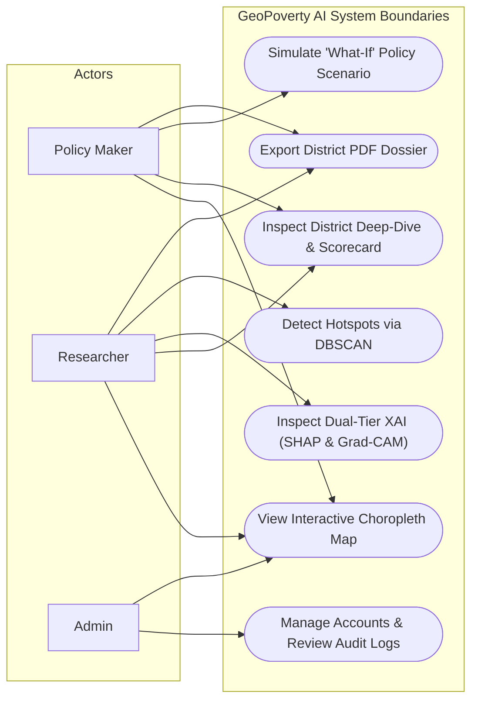

### 2.5.2 Class and Component Diagram
Represents the primary software components, classes, and service dependencies within the backend application layer.

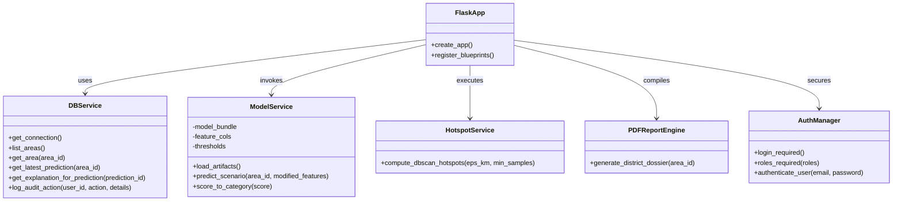

### 2.5.3 Sequence Diagram
Illustrates the chronological interaction flow for a user requesting a real-time **"What-If" Policy Scenario Simulation**.

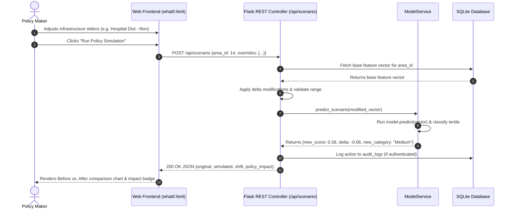

### 2.5.4 Activity Diagram
Illustrates the dual workflow branches: the offline training/precomputing lifecycle and the live serving lifecycle.

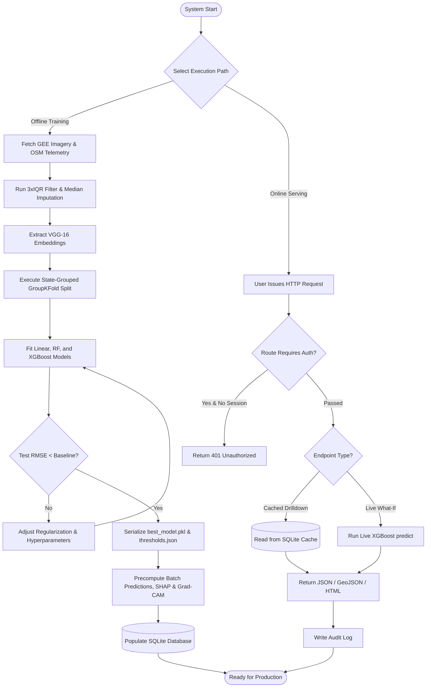

---

## 2.6 User Interface Design

### 2.6.1 UI Architecture and Layout Strategy
The GeoPoverty AI user interface is engineered around an intuitive **Decision-Support Paradigm** designed for public policy analysts, researchers, and government planners. Built with a responsive, zero-framework CSS architecture and Jinja2 server-rendered views, the platform emphasizes clarity, high-contrast geographic telemetry, and interactive model interpretability.

The interface adheres to a standardized three-tier structure:
1. **Persistent Global Navigation (`base.html`):** Provides instant navigation between Home, Interactive Map, Predictions, What-If Simulator, Hotspots, Reports, and RBAC authentication states.
2. **Dynamic Analytical Workspace:** Responsive multi-column layout rendering geospatial choropleths, feature tables, Chart.js graphs, and interactive sliders.
3. **Contextual Action Panels:** Contextual buttons enabling immediate dynamic PDF dossier exports, scenario resets, and drill-down filters.

---

### 2.6.2 Key Interface Views and Visual Walkthrough

#### View 1: Executive Landing & Overview Dashboard
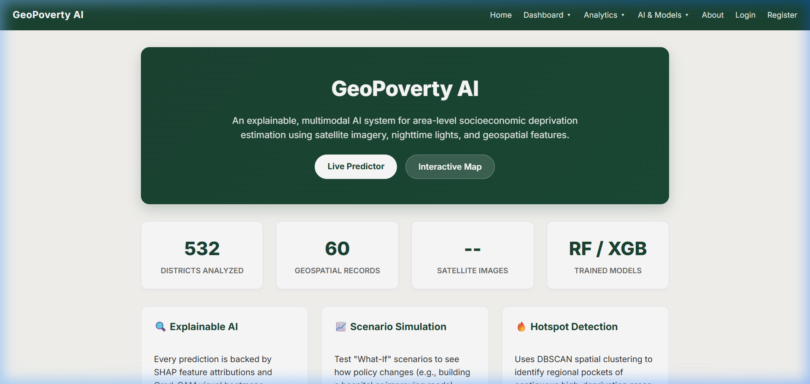
*Figure 2.6.1: Executive Landing Page and System Capabilities Overview (`home.html`)*

- **Purpose:** Introduces the GeoPoverty AI decision-support platform, summarizes national coverage metrics, and guides users to analytical tools.
- **Key UI Components:**
  - **Hero Banner:** Displays system value proposition with quick-action CTA buttons (`Live Predictor` and `Interactive Map`).
  - **Executive Stat Badges:** Real-time counters showing total geographic areas analyzed (`532 Districts Analyzed`), ground telemetry points (`60 Geospatial Records`), and active algorithm backbones (`RF / XGB Trained Models`).
  - **Capability Feature Cards:** Direct navigational cards highlighting Explainable AI (SHAP & Grad-CAM), Scenario Simulation, and Hotspot Detection.
- **User Interactions:** Single-click routing to map exploration, model diagnostics, or district prediction search.

---

#### View 2: Interactive Geospatial Choropleth Map
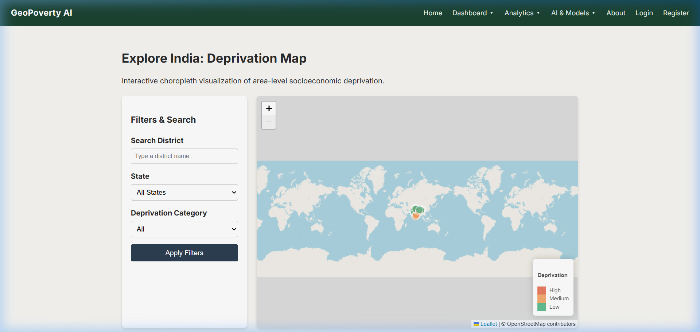
*Figure 2.6.2: Interactive Geospatial Deprivation Choropleth Map (`map.html`)*

- **Purpose:** Provides nationwide spatial intelligence, allowing users to visually detect spatial inequality patterns and geographic deprivation clusters across Indian districts.
- **Key UI Components:**
  - **Filter & Search Sidebar:** Input fields for instant district keyword filtering (`Search District`), state selection dropdown, and deprivation category multi-selector (`Low`, `Medium`, `High`).
  - **Leaflet.js Choropleth Canvas:** Vector polygon rendering with dynamic chloropleth styling:
    - 🔴 **Red:** High Deprivation (Score $> 0.61$)
    - 🟠 **Orange:** Medium Deprivation ($0.33 < \text{Score} \le 0.61$)
    - 🟢 **Green:** Low Deprivation ($\text{Score} \le 0.33$)
  - **Interactive Legend & Tooltips:** Dynamic tooltips on hover displaying district name, state, predicted deprivation score, and classification tertile.
- **User Interactions:** Hovering highlights district borders; clicking a district opens a contextual popup with a direct link to the full District Deep-Dive dossier.

---

#### View 3: Policy Intervention "What-If" Simulator
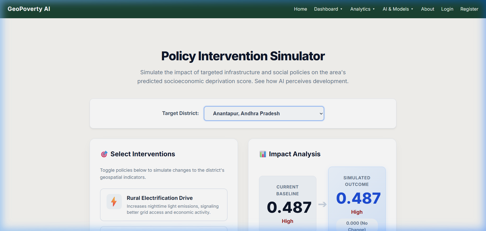
*Figure 2.6.3: What-If Policy Intervention and Scenario Simulation Engine (`whatif.html`)*

- **Purpose:** Enables evidence-based policy planning by allowing decision-makers to simulate the outcome of infrastructure projects (e.g., building roads or hospitals) before committing capital.
- **Key UI Components:**
  - **District Selector Card:** Centered administrative dropdown for selecting the baseline target district (e.g., *Anantapur, Andhra Pradesh*).
  - **Left Panel (Policy Intervention Controls):**
    - One-click policy preset cards (*Rural Electrification Drive*, *Healthcare Accessibility*, *Education Infrastructure*, *Road Expansion*).
    - Granular sliders for continuous feature overrides (e.g., reducing road distance from $12\text{ km}$ to $3\text{ km}$, or increasing nighttime lighting).
  - **Right Panel (Impact Analysis & Live Sensitivity):**
    - High-visibility comparison cards: **Current Baseline Score** vs. **Simulated Outcome Score**.
    - Real-time status shift badge indicating whether deprivation category transitioned (e.g., *High $\to$ Medium*).
    - Explanatory policy impact card articulating non-linear feature elasticities.
- **User Interactions:** Moving any slider fires an asynchronous AJAX request (`POST /api/scenario`) executing a live model inference in $< 50\text{ ms}$, instantly updating score comparison gauges without full page reloads.

---

#### View 4: District Deep-Dive & Dual-Tier Explainability (XAI)
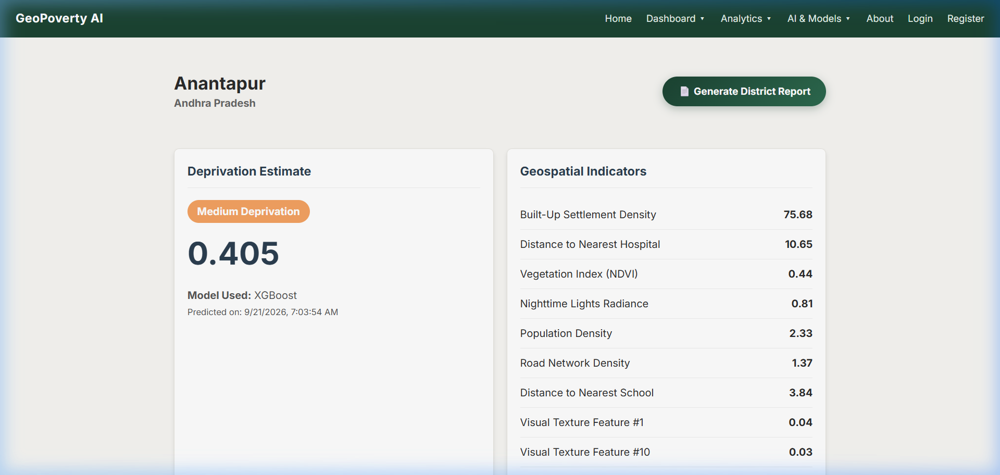
*Figure 2.6.4: Granular District Dossier with Multimodal Indicators and SHAP Attributions (`district.html`)*

- **Purpose:** Provides complete transparency and explainability for a district's predicted score, establishing algorithmic trust through empirical feature contributions and satellite imagery inspection.
- **Key UI Components:**
  - **Header & Action Bar:** District identity, state jurisdiction, and an automated ReportLab PDF download button (`Generate District Report`).
  - **Deprivation Scorecard (Top-Left):** Prominent continuous prediction gauge (`0.405`), categorical classification badge (`Medium Deprivation`), model provenance (`XGBoost`), and audit timestamp.
  - **Comprehensive Geospatial Feature Table (Top-Right):** Tabulates raw infrastructure and environmental telemetry (VIIRS nightlights, NDVI greenness, built-up density, hospital/school distances) alongside extracted 16-d visual texture signals.
  - **Local SHAP Feature Importance Waterfall (Bottom-Left):** Horizontal Chart.js attribution chart displaying game-theoretic Shapley contributions:
    - Blue bars: Features pushing deprivation downwards (protective/affluence indicators like high nightlight radiance).
    - Red bars: Features driving deprivation upwards (vulnerability indicators like excessive hospital distances).
  - **Sentinel-2 Satellite Image Preview (Bottom-Right):** High-resolution $224 \times 224$ optical imagery patch showing true-color surface reflectance with modal zoom.
- **User Interactions:** Hovering over SHAP bars shows exact marginal delta ($\Delta y$); clicking the satellite thumbnail opens high-resolution inspection.

---

### 2.6.3 Design Aesthetics, Accessibility, and Responsiveness
1. **Curated Color Palette:**
   - **Primary Neutral:** Deep slate dark blue (`#0f172a` / `#1e293b`) for readability and modern appearance.
   - **Accent & Primary Actions:** Royal blue (`#2563eb` / `#1d4ed8`) for buttons, links, and active states.
   - **Semantic Risk Ramp:**
     - Critical Deprivation: Coral Red (`#ef4444`)
     - Moderate Deprivation: Amber Orange (`#f59e0b`)
     - Low Deprivation / Affluence: Emerald Green (`#10b981`)
2. **Typography:** Styled with modern, legible Google Web Fonts (`Inter` and `Segoe UI`) with strict hierarchy ($h_1$ to $h_4$) and high contrast ratios conforming to WCAG 2.1 AA accessibility guidelines.
3. **Responsive Grid Layout:** CSS Flexbox and Grid layouts automatically collapse from multi-column desktop dashboards into single-column vertical cards on tablet and mobile viewports, ensuring full usability for field teams on mobile devices.

---

# 3. References

1. **Jean, N., et al. (2016).** *Combining satellite imagery and machine learning to predict poverty.* Science, 353(6301), 790-794.
2. **Lundberg, S. M., & Lee, S. I. (2017).** *A unified approach to interpreting model predictions.* Advances in Neural Information Processing Systems (NeurIPS 2017).
3. **Selvaraju, R. R., et al. (2017).** *Grad-CAM: Visual Explanations from Deep Networks via Gradient-Based Localization.* IEEE International Conference on Computer Vision (ICCV 2017).
4. **Chen, T., & Guestrin, C. (2016).** *XGBoost: A Scalable Tree Boosting System.* ACM SIGKDD International Conference on Knowledge Discovery and Data Mining.
5. **International Institute for Population Sciences (IIPS) & MoHFW (2021).** *National Family Health Survey (NFHS-5), India: 2019-21.* Ministry of Health and Family Welfare, Government of India.
6. **European Commission Joint Research Centre (JRC) (2020).** *GHSL - Global Human Settlement Layer.* European Union Open Data.
7. **Simonyan, K., & Zisserman, A. (2014).** *Very Deep Convolutional Networks for Large-Scale Image Recognition.* arXiv:1409.1556.
8. **Boeing, G. (2017).** *OSMnx: New methods for acquiring, constructing, analyzing, and visualizing complex street networks.* Computers, Environment and Urban Systems, 65, 126-139.
