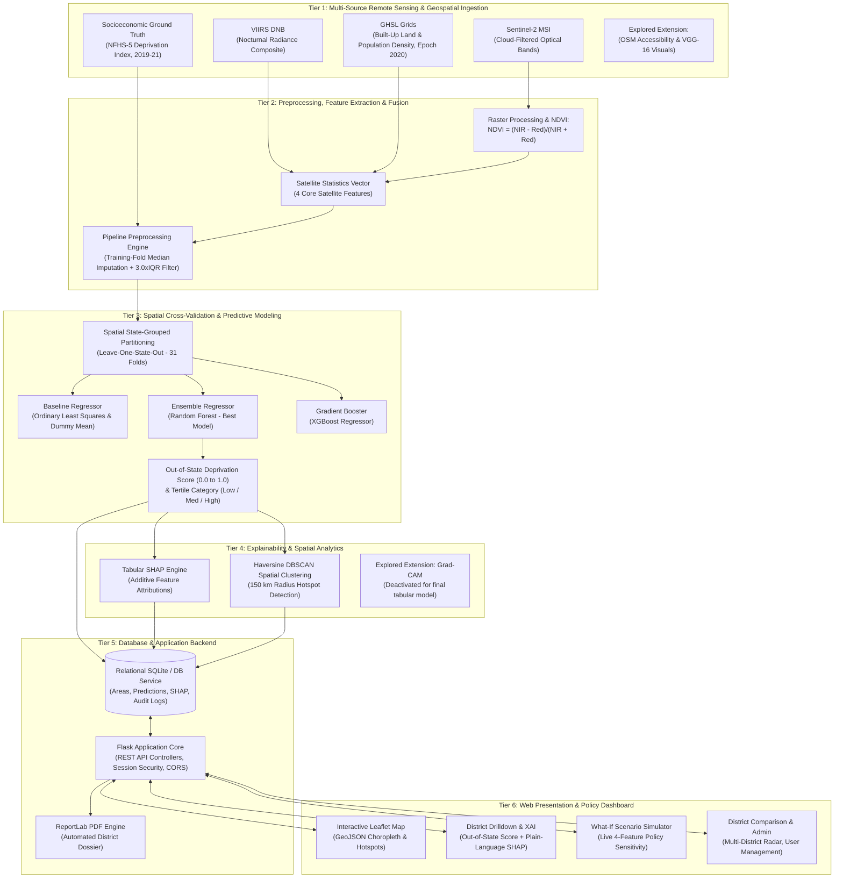

# SYSTEM ARCHITECTURE SPECIFICATION
## GeoPoverty AI: Multimodal Explainable AI System for Area-Level Socioeconomic Deprivation Estimation

---

## 1. Architectural Overview

GeoPoverty AI is architected as a **6-Tier Modular Geospatial AI Platform**. It integrates multi-source earth observation telemetry, spatial gradient-boosted and tree-based regression, game-theoretic explainable AI (SHAP), and an interactive decision-support web application.

```text
+-------------------------------------------------------------------------------+
|                       TIER 6: CLIENT PRESENTATION LAYER                       |
|   Leaflet.js Map | Chart.js XAI | District Drilldown | Scenario Simulator     |
+---------------------------------------▲---------------------------------------+
                                        │ HTTP / JSON / GeoJSON / PNG
+---------------------------------------▼---------------------------------------+
|                       TIER 5: APPLICATION & BACKEND API                       |
|   Flask 3.0.3 Web App | REST Endpoints (/api/*) | Session RBAC | PDF Engine   |
+---------------------------------------▲---------------------------------------+
                                        │ SQL Queries & Service Invocations
+---------------------------------------▼---------------------------------------+
|                    TIER 4: EXPLAINABLE AI & ANALYTICS ENGINE                  |
|   SHAP (TreeExplainer) | Haversine DBSCAN Hotspots (150 km radius)            |
+---------------------------------------▲---------------------------------------+
                                        │ Predictions & Out-of-State Scores
+---------------------------------------▼---------------------------------------+
|                   TIER 3: PREDICTIVE MODELING & INFERENCE                     |
|   Random Forest | XGBoost | Leave-One-State-Out CV (No Spatial Leakage)       |
+---------------------------------------▲---------------------------------------+
                                        │ Fused Tabular Feature Vector (4 Satellite Features)
+---------------------------------------▼---------------------------------------+
|                  TIER 2: PREPROCESSING & PIPELINE FEATURE FUSION               |
|   4 Core Satellite Features | 3xIQR Outlier Filter | Training-Fold Median     |
+---------------------------------------▲---------------------------------------+
                                        │ Raw Geometries, Rasters, Survey Stats
+---------------------------------------▼---------------------------------------+
|                     TIER 1: MULTI-SOURCE INGESTION & DATA                     |
|   Sentinel-2 MSI | VIIRS Nightlights | GHSL Built-Up & Population | NFHS-5    |
+-------------------------------------------------------------------------------+
```

---

## 2. Comprehensive System Architecture Diagram



---

## 3. Detailed Component Breakdown by Layer

### Layer 1: Data Ingestion & Remote Sensing Telemetry
* **Sentinel-2 MultiSpectral Instrument (MSI):** Pulls cloud-filtered surface reflectance images from Earth Engine (2019-11-01 to 2021-04-30). Computes Normalized Difference Vegetation Index ($NDVI = \frac{\text{NIR} - \text{Red}}{\text{NIR} + \text{Red}}$) at 100 m scale (250 m for large-geometry refilled districts).
* **VIIRS Day/Night Band (DNB):** Captures nocturnal artificial lighting ($nW \cdot cm^{-2} \cdot sr^{-1}$) serving as a proxy for electrification and commercial activity.
* **Global Human Settlement Layer (GHSL):** Measures built-up surface land percentage (`builtup_pct`) and population density grid (`population_density`) at epoch 2020.
* **Socioeconomic Ground Truth:** Standardized deprivation scores ($Y \in [0.0, 1.0]$) derived from five NFHS-5 survey indicators (sanitation, electricity, clean cooking fuel, child stunting, and maternal anaemia).

### Layer 2: Preprocessing & Multimodal Feature Selection
* **Active Model Features:** The final model uses **4 features only**:
  1. `nightlight_mean`
  2. `ndvi_mean`
  3. `builtup_pct`
  4. `population_density`
* **Explored Extensions:**
  * Deep visual features (VGG-16) were evaluated only in an exploratory run on the original project dataset (data/exploratory/original_table_with_visual_features.csv; 2023 imagery). In that run, leave-one-state-out R2 was 0.3273 without the visual features (using 7 tabular features: 4 satellite + 3 accessibility columns, not the final 4-feature model) and 0.2879 with them, and visual features alone gave 0.0702 (models/exploratory_visual_ablation/ablation_results.csv). They were not re-evaluated on the final 2019-21 data, and the final model does not use them.
  * The accessibility columns in the original dataset (road density, school and hospital distance) could not be traced to an extraction script and were almost perfectly correlated with each other (|r| about 0.96); removing the accessibility columns changed R2 by about 0.003 (0.288 to 0.291) when the visual features were present, so they were not used. An OSM extraction script is included for future work but was not run nationally.
* **Robust Preprocessing Inside Pipeline:** Missing values are handled via **training-fold median inside the pipeline** to prevent data leakage. Outliers are bounded with a relaxed $3.0 \times \text{IQR}$ threshold clipping within the pipeline.

### Layer 3: Geography-Aware Modeling & Cross-Validation
* **Spatial Autocorrelation Defense:** Standard random K-Fold splits suffer from geographic data leakage. GeoPoverty AI enforces **Leave-One-State-Out (LOSO) Cross-Validation**, holding out entire contiguous states during validation.
* **Model Engine:** 
  * Linear & Ridge Regression (Baselines)
  * Random Forest Regressor (**Best Model**, selected based on LOSO RMSE and MAE)
  * Gradient Boosting & XGBoost Regressors
* **Categorical Discretization:** Deprivation scores are categorized into `Low`, `Medium`, and `High` using empirical tertile boundaries established strictly on training folds.
* **Benchmark Metrics:** All model metrics are documented in [`documentation/RESULTS.md`](RESULTS.md), matching [`models/model_comparison_results.csv`](../models/model_comparison_results.csv).

### Layer 4: Explainable AI (XAI) & Spatial Analytics
* **Tabular Explainability (SHAP):** Calculates game-theoretic Shapley values decomposing each district prediction:
  $$\hat{y}_i = \phi_0 + \sum_{j=1}^{4} \phi_{ij}$$
  Ensures that $\phi_0 + \sum \phi_{ij} = \text{predicted\_score}$ within floating-point tolerance ($\le 10^{-4}$).
* **Spatial Clustering (Haversine DBSCAN):** Executes density-based spatial clustering using the **Haversine metric with 150 km radius** (`eps = 150 / 6371 \approx 0.02354` radians, `min_samples = 3`) on district centroids for districts classified with 'High' deprivation.
* **Grad-CAM Deactivation:** Marked as not available (`gradcam_available: false`) with reason: *"The current model uses satellite statistics only, not image features."*

### Layer 5: Backend & Data Persistence Layer
* **Storage (SQLite 3):** Relational schema containing tables (`areas`, `predictions`, `explanations`, `ground_truth`, `geospatial_features`, `satellite_data`, `users`, `audit_logs`).
* **Services (Flask 3.x):**
  * `db_service.py`: Query dispatch and thread-safe database operations.
  * `model_service.py`: Model loading, inference, and live What-If policy sensitivity calculations.
  * `hotspot_service.py`: Haversine DBSCAN clustering execution with 150 km radius.
  * `reports.py`: Automated dynamic PDF dossier compilation using ReportLab 5.0.1.

### Layer 6: User Interface & Decision Support Layer
* **Choropleth Mapping:** Interactive Leaflet.js engine rendering district polygons with color ramps tied to out-of-state deprivation estimates.
* **District Intelligence Dashboard:** Visualizes out-of-state prediction score with 80% uncertainty bounds, Sentinel-2 image, and horizontal SHAP contribution bars with plain-language explanations.
* **What-If Scenario Simulator:** Interactive interface allowing policymakers to adjust the 4 satellite indicators and inspect predicted shifts in deprivation.
* **Role-Based Access Control (RBAC):** Tiered authorization (`PUBLIC`, `RESEARCHER`, `ADMIN`) with memory-based rate limiting (5 failed login attempts per 15 minutes).

---

## 4. End-to-End Data Flow Sequence

```text
[Raw Satellite Telemetry (Sentinel-2, VIIRS, GHSL)]
         │
         ▼
[Feature Extraction & Pipeline Fusion] ────────► [final_training_table.csv (4 Features)]
                                                                  │
         ┌────────────────────────────────────────────────────────┴────────────────────────┐
         ▼                                                                                 ▼
[Offline Training / Leave-One-State-Out]                                      [Precompute Script]
         │                                                                                 │
         ▼                                                                                 ▼
[best_model.pkl & run_metadata.json] ────────────────────────► [Out-of-State Predictions & Consistent SHAP]
                                                                                           │
                                                                                           ▼
                                                                                  [Database (geopoverty.db)]
                                                                                           ▲
                                                                                           │
                                                                               [Flask REST API Service]
                                                                                           ▲
                                                                                           │
                                                                           [Interactive Frontend Dashboard]
```

1. **Ingest:** Google Earth Engine extracts Sentinel-2 NDVI, VIIRS nocturnal radiance, and GHSL built-up & population grids.
2. **Transform:** Tabular satellite statistics are merged into `final_training_table.csv` using state-contained district matching.
3. **Train:** `train_models.py` executes Leave-One-State-Out cross-validation and serializes the best model bundle (`RandomForest`).
4. **Precompute:** `scripts/precompute_predictions.py` fits per-state pipelines on other states to compute out-of-state estimates and additive SHAP explanations into SQLite.
5. **Serve:** Flask REST endpoints deliver GeoJSON layers, analytical charts, PDF reports, and real-time What-If scenario evaluations to the web client.
