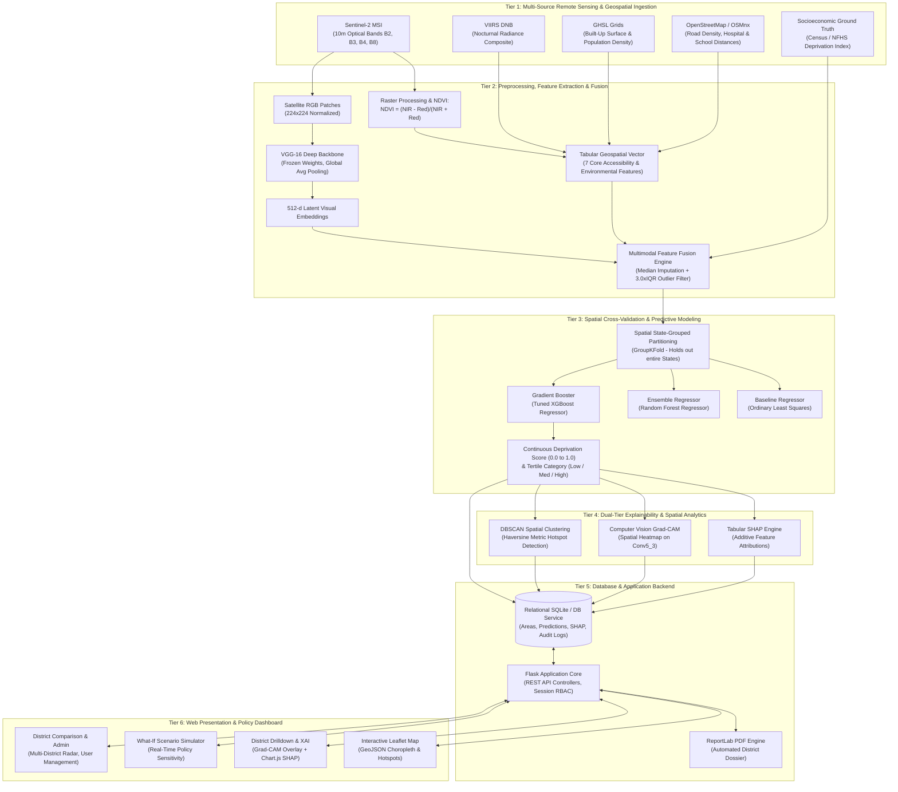

# SYSTEM ARCHITECTURE SPECIFICATION
## GeoPoverty AI: Multimodal Explainable AI System for Area-Level Socioeconomic Deprivation Estimation

---

## 1. Architectural Overview

GeoPoverty AI is architected as a **6-Tier Modular Geospatial AI Platform**. It integrates multi-source earth observation telemetry, deep visual representation learning, spatial gradient-boosted regression, dual-tier explainable AI (XAI), and an interactive decision-support web application.

```
+-------------------------------------------------------------------------------+
|                       TIER 6: CLIENT PRESENTATION LAYER                       |
|   Leaflet.js Map | Chart.js XAI | District Drilldown | Scenario Simulator     |
+---------------------------------------▲---------------------------------------+
                                        │ HTTP / JSON / GeoJSON / PNG
+---------------------------------------▼---------------------------------------+
|                       TIER 5: APPLICATION & BACKEND API                       |
|   Flask 3.0.3 Web App | REST Endpoints (/api/*) | Session RBAC | PDF Engine   |
+---------------------------------------▲---------------------------------------+
                                        │ SQL Queries & Service Invocations
+---------------------------------------▼---------------------------------------+
|                    TIER 4: EXPLAINABLE AI & ANALYTICS ENGINE                  |
|   SHAP (TreeExplainer) | Grad-CAM Visual Heatmaps | DBSCAN Hotspot Clustering |
+---------------------------------------▲---------------------------------------+
                                        │ Predictions & Latent Embeddings
+---------------------------------------▼---------------------------------------+
|                   TIER 3: PREDICTIVE MODELING & INFERENCE                     |
|   XGBoost Regressor | Random Forest | State-Grouped CV (No Spatial Leakage)   |
+---------------------------------------▲---------------------------------------+
                                        │ Fused Tabular Feature Vector (N x 521)
+---------------------------------------▼---------------------------------------+
|                  TIER 2: DEEP VISION & MULTIMODAL FEATURE FUSION               |
|   Frozen VGG-16 Backbone (512-d) | 3xIQR Outlier Filter | Median Imputation   |
+---------------------------------------▲---------------------------------------+
                                        │ Raw Geometries, Rasters, Survey Stats
+---------------------------------------▼---------------------------------------+
|                     TIER 1: MULTI-SOURCE INGESTION & DATA                     |
|   Sentinel-2 MSI | VIIRS Nightlights | GHSL Built-Up | OSMnx | Census / NFHS  |
+-------------------------------------------------------------------------------+
```

---

## 2. Comprehensive System Architecture Diagram



---

## 3. Detailed Component Breakdown by Layer

### Layer 1: Data Ingestion & Geospatial Telemetry
* **Sentinel-2 MultiSpectral Instrument (MSI):** Pulls cloud-free surface reflectance images. Computes 10-meter resolution Normalized Difference Vegetation Index ($NDVI$).
* **VIIRS Day/Night Band (DNB):** Captures nocturnal artificial lighting ($nW \cdot cm^{-2} \cdot sr^{-1}$) serving as a primary proxy for electrification and commercial activity.
* **Global Human Settlement Layer (GHSL):** Measures human footprint percentages and population distribution grids.
* **OpenStreetMap (via OSMnx):** Queries district road networks (road density $km/km^2$) and computes Euclidean distances to critical social infrastructure (hospitals, schools).
* **Ground Truth:** Standardized deprivation scores ($Y \in [0.0, 1.0]$) derived from national census indicators.

### Layer 2: Deep Feature Extraction & Multimodal Fusion
* **Vision Backbone:** Pre-trained VGG-16 architecture with classification head stripped, utilizing Global Average Pooling on `block5_conv3` to extract a dense **512-dimensional visual vector** per district patch.
* **Feature Fusion:** Concatenates tabular geospatial signals with visual embeddings into a unified matrix:
  $$\mathbf{X}_{\text{fused}} = [\mathbf{x}_{\text{geospatial}} \parallel \mathbf{v}_{\text{vgg16}}] \in \mathbb{R}^{N \times (7 + 512)}$$
* **Robust Preprocessing:** Handles missing values with median imputation calculated strictly inside training folds. Applies a relaxed $3.0 \times \text{IQR}$ clipping to preserve genuine geographic extremes.

### Layer 3: Geography-Aware Modeling & Cross-Validation
* **Spatial Autocorrelation Defense:** Standard random K-Fold splits suffer from geographic data leakage. GeoPoverty AI enforces **State-Grouped Cross-Validation (`GroupKFold`)**, holding out entire contiguous states during validation.
* **Model Engine:** 
  * Linear Regression (Baseline)
  * Random Forest Regressor
  * Tuned XGBoost Regressor (Optimized via `RandomizedSearchCV`)
* **Categorical Discretization:** Deprivation scores are categorized into `Low`, `Medium`, and `High` using empirical tertile boundaries established on training sets.

### Layer 4: Dual-Tier Explainable AI (XAI) & Spatial Analytics
* **Tabular Explainability (SHAP):** Calculates game-theoretic Shapley values decomposing each district prediction:
  $$\hat{y}_i = \phi_0 + \sum_{j=1}^{M} \phi_{ij}$$
* **Vision Explainability (Grad-CAM):** Calculates gradient activations at `block5_conv3` to highlight specific geographic terrain patterns (e.g., agricultural land, unpaved tracts, dense urban clusters) responsible for feature activations.
* **Spatial Clustering (DBSCAN):** Executes density-based spatial clustering using Haversine distance on geographic centroids to isolate multi-district regional poverty corridors.

### Layer 5: Backend & Data Persistence Layer
* **Storage (SQLite 3):** Relational schema containing 9 tables (`areas`, `predictions`, `explanations`, `ground_truth`, `geospatial_features`, `satellite_data`, `model_results`, `users`, `audit_logs`).
* **Microservices (Flask 3.x):**
  * `db_service.py`: Query dispatch and transaction management.
  * `model_service.py`: Model inference and live "What-If" policy sensitivity calculations.
  * `hotspot_service.py`: DBSCAN cluster execution.
  * `reports.py`: Automated dynamic PDF dossier compilation using ReportLab.

### Layer 6: User Interface & Decision Support Layer
* **Choropleth Mapping:** Interactive Leaflet.js engine rendering district polygons with color ramps tied to deprivation categories.
* **District Intelligence Dashboard:** Visualizes fused prediction score, VGG-16 Grad-CAM overlay, and Chart.js horizontal SHAP attribution chart.
* **What-If Scenario Simulator:** Interactive interface allowing policymakers to adjust infrastructure inputs (e.g., road distance, electrification) and inspect predicted shifts in deprivation.
* **Role-Based Access Control (RBAC):** Tiered authorization (`PUBLIC`, `RESEARCHER`, `ADMIN`) with audit logging.

---

## 4. End-to-End Data Flow Sequence

```
[Raw Satellite / Telemetry]
         │
         ▼
[Preprocessing & Feature Fusion] ────────► [Fused Feature Table (CSV)]
                                                   │
         ┌─────────────────────────────────────────┴─────────────────────────────────────────┐
         ▼                                                                                   ▼
[Offline Training / GroupKFold]                                                     [Precompute Script]
         │                                                                                   │
         ▼                                                                                   ▼
[Tuned Models (.pkl) & Thresholds] ─────────────────────────────────────────► [Batch Predictions & SHAP/Grad-CAM]
                                                                                             │
                                                                                             ▼
                                                                                   [Relational Database (SQLite)]
                                                                                             ▲
                                                                                             │
                                                                                [Flask REST API Service]
                                                                                             ▲
                                                                                             │
                                                                           [Interactive Frontend Dashboard]
```

1. **Ingest:** Google Earth Engine and OpenStreetMap scripts fetch district boundaries, optical imagery, nightlight radiance, and accessibility parameters.
2. **Transform:** Satellite images are processed through VGG-16; tabular indices are computed and fused into `final_training_table.csv`.
3. **Train:** `train_models.py` performs state-level cross-validation, serializing the best model and tertile thresholds.
4. **Precompute:** Predictions, SHAP decompositions, and Grad-CAM PNG heatmaps are generated and cached in SQLite to guarantee instantaneous dashboard loading (< 100ms response time).
5. **Serve:** Flask REST endpoints deliver GeoJSON layers, analytical charts, PDF reports, and real-time scenario evaluations to the web client.
