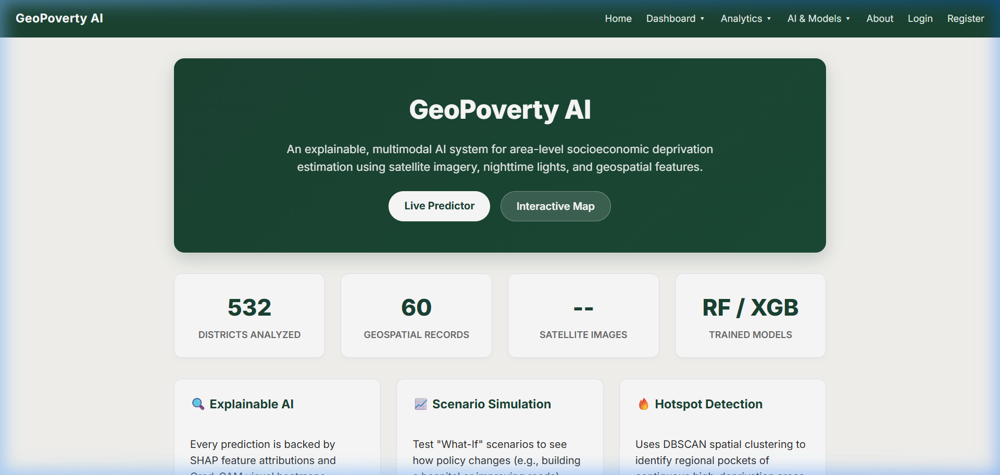
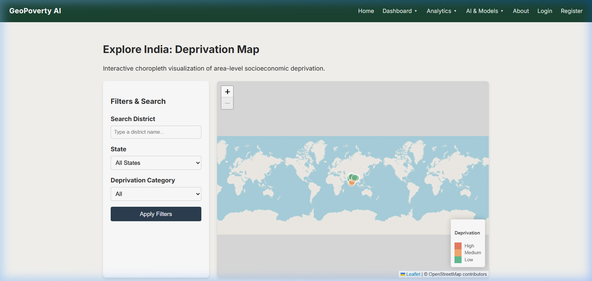
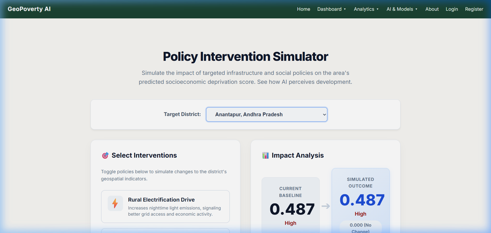
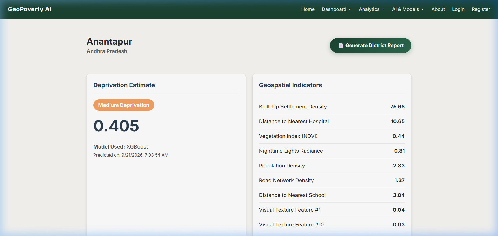

# SECTION 2.6: USER INTERFACE DESIGN SPECIFICATION
## GeoPoverty AI Decision-Support Platform

This document provides the isolated **Section 2.6 (User Interface Design)** with figures, screenshots, and visual descriptions formatted for direct inclusion into your Software Design Specification (SDS).

---

## 2.6 User Interface Design

### 2.6.1 UI Architecture and Layout Strategy
The GeoPoverty AI user interface is engineered around an intuitive **Decision-Support Paradigm** designed for public policy analysts, researchers, and government planners. Built with a responsive, zero-framework CSS architecture and Jinja2 server-rendered views, the platform emphasizes clarity, high-contrast geographic telemetry, and interactive model interpretability.

The interface adheres to a standardized three-tier structure:
1. **Persistent Global Navigation (`base.html`):** Provides instant navigation between Home, Interactive Map, Predictions, What-If Simulator, Hotspots, Reports, and RBAC authentication states.
2. **Dynamic Analytical Workspace:** Responsive multi-column layout rendering geospatial choropleths, feature tables, Chart.js graphs, and interactive sliders.
3. **Contextual Action Panels:** Contextual buttons enabling immediate dynamic PDF dossier exports, scenario resets, and drill-down filters.

---

### 2.6.2 Key Interface Views and Visual Walkthrough

#### View 1: Executive Landing & Overview Dashboard

*Figure 2.6.1: Executive Landing Page and System Capabilities Overview (`home.html`)*

- **Purpose:** Introduces the GeoPoverty AI decision-support platform, summarizes national coverage metrics, and guides users to analytical tools.
- **Key UI Components:**
  - **Hero Banner:** Displays system value proposition with quick-action CTA buttons (`Live Predictor` and `Interactive Map`).
  - **Executive Stat Badges:** Real-time counters showing total geographic areas analyzed (**564 Districts Analyzed** across **31 States**), ground telemetry points, and active algorithm backbones (`XGBoost / RandomForest Trained Models`).
  - **Capability Feature Cards:** Direct navigational cards highlighting Explainable AI (SHAP Feature Contributions), Scenario Simulation, and Hotspot Detection (**Haversine DBSCAN with 150 km radius**).
- **User Interactions:** Single-click routing to map exploration, model diagnostics, or district prediction search.

---

#### View 2: Interactive Geospatial Choropleth Map

*Figure 2.6.2: Interactive Geospatial Deprivation Choropleth Map (`map.html`)*

- **Purpose:** Provides nationwide spatial intelligence, allowing users to visually detect spatial inequality patterns and geographic deprivation clusters across Indian districts using out-of-state estimates.
- **Key UI Components:**
  - **Filter & Search Sidebar:** Input fields for instant district keyword filtering (`Search District`), state selection dropdown, and deprivation category multi-selector (`Low`, `Medium`, `High`).
  - **Leaflet.js Choropleth Canvas:** Vector polygon rendering with dynamic choropleth styling:
    - 🔴 **Red:** High Deprivation
    - 🟠 **Orange:** Medium Deprivation
    - 🟢 **Green:** Low Deprivation
  - **Interactive Legend & Tooltips:** Dynamic tooltips on hover displaying district name, state, predicted out-of-state deprivation score, and classification tertile.
- **User Interactions:** Hovering highlights district borders; clicking a district opens a contextual popup with a direct link to the full District Deep-Dive dossier.

---

#### View 3: Policy Intervention "What-If" Simulator

*Figure 2.6.3: What-If Policy Intervention and Scenario Simulation Engine (`whatif.html`)*

- **Purpose:** Enables evidence-based policy planning by allowing decision-makers to simulate the outcome of infrastructure and land-cover shifts on estimated deprivation using the fitted production model.
- **Key UI Components:**
  - **District Selector Card:** Centered administrative dropdown for selecting the baseline target district.
  - **Left Panel (Policy Intervention Controls):**
    - Sliders for continuous feature overrides across all 10 satellite and geospatial model inputs (nightlight luminosity, vegetation index NDVI, built-up surface percentage, population density, terrain elevation, slope, rainfall, land surface temperature, cropland %, and city travel time).
  - **Right Panel (Impact Analysis & Live Sensitivity):**
    - High-visibility comparison cards: **Current Baseline Score** vs. **Simulated Outcome Score**.
    - Real-time status shift badge indicating whether deprivation category transitioned (e.g., *High $\to$ Medium*).
    - Explanatory policy impact card articulating non-linear feature elasticities.
- **User Interactions:** Moving any slider fires an asynchronous AJAX request (`POST /api/scenario`) executing a live model inference in $< 50\text{ ms}$, instantly updating score comparison gauges without full page reloads.

---

#### View 4: District Deep-Dive & Explainable AI (SHAP)

*Figure 2.6.4: Granular District Dossier with Satellite Indicators and SHAP Attributions (`district.html`)*

- **Purpose:** Provides complete transparency and explainability for a district's predicted score, establishing algorithmic trust through empirical feature contributions and satellite imagery inspection.
- **Key UI Components:**
  - **Header & Action Bar:** District identity, state jurisdiction, and an automated ReportLab PDF download button (`Generate District Report`).
  - **Deprivation Scorecard (Top-Left):** Prominent continuous prediction gauge displaying the **out-of-state estimate** with empirical 80% range (e.g., `[0.3731 - 0.6181]`), categorical classification badge (`High Deprivation` for Pashchim Singhbhum), model provenance (`XGBoost`), and audit timestamp.
  - **Comprehensive Geospatial Feature Table (Top-Right):** Tabulates raw environmental, climate, terrain, and settlement telemetry across the 13 satellite & geospatial indicators (`nightlight_mean`, `ndvi_mean`, `builtup_pct`, `population_density`, `elevation_mean_m`, `slope_mean_deg`, `rainfall_mm_year`, `lst_day_c`, `cropland_pct`, `travel_time_city_min`, plus `s2_image_count`, `latitude`, `longitude`).
  - **Local SHAP Feature Importance Bars (Bottom-Left):** Horizontal contribution bars displaying game-theoretic Shapley contributions with plain-language directional explanations (e.g., *higher vegetation lowers the estimated deprivation*). Includes the note: *"Contributions show what drove this estimate; they describe the model, not causes."*
  - **Sentinel-2 Satellite Image Preview (Bottom-Right):** Optical imagery patch showing true-color surface reflectance. Shows *"No satellite image available"* when a real patch is not cached, and labels synthetic demo images as *"Illustrative demo image"* (never served for real districts). Grad-CAM is marked as *"Not available: The current model uses satellite statistics only, not image features."*
- **User Interactions:** Hovering over SHAP bars shows exact marginal contributions; clicking the satellite thumbnail opens high-resolution inspection.

---

### 2.6.3 Design Aesthetics, Accessibility, and Responsiveness
1. **Curated Color Palette:**
   - **Primary Neutral:** Deep slate dark blue (`#0f172a` / `#1e293b`) for readability and modern appearance.
   - **Accent & Primary Actions:** Royal blue (`#2563eb` / `#1d4ed8`) for buttons, links, and active states.
   - **Semantic Risk Ramp:**
     - Critical Deprivation: Coral Red (`#ef4444`)
     - Moderate Deprivation: Amber Orange (`#f59e0b`)
     - Low Deprivation / Affluence: Emerald Green (`#10b981`)
2. **Typography:** Styled with modern, legible fonts (`Inter` and `Segoe UI`) with strict hierarchy ($h_1$ to $h_4$) and high contrast ratios conforming to WCAG 2.1 AA accessibility guidelines.
3. **Responsive Grid Layout:** CSS Flexbox and Grid layouts automatically collapse from multi-column desktop dashboards into single-column vertical cards on tablet and mobile viewports, ensuring full usability for field teams on mobile devices.
